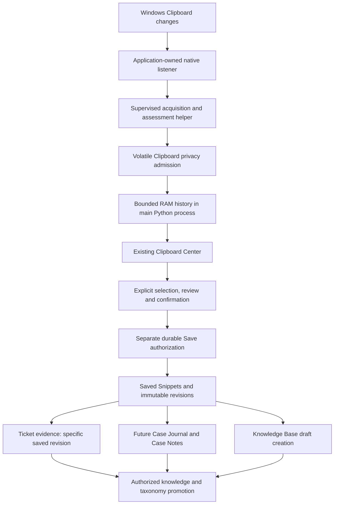
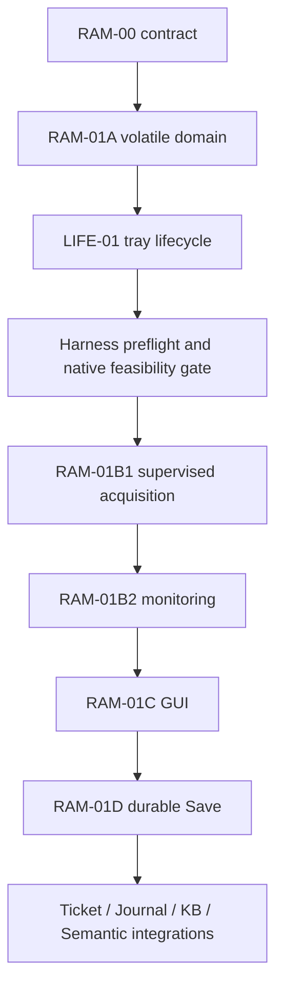

# F7Hub Clipboard RAM-01: Volatile History and Explicit Promotion

## Document control and authorization

| Field | Value |
| --- | --- |
| Contract | RAM-00 successor for RAM-01 delivery |
| Owner approval | Revised architecture explicitly accepted by the owner on 2026-10-25, America/Toronto |
| Document candidate | Documentation-only encoding; independent review pending; not integrated |
| Requested handoff | READY_FOR_INDEPENDENT_REVIEW after focused documentation validation |
| Authorized worktree | `C:\Dev\F7Hub-Clipboard-RAM01-Docs` |
| Branch | `docs/clipboard-ram01-contract` |
| Expected HEAD / inspected main | `0e2391a988eff7377acf4a1b3f98ad2b8fe8b6b7` |
| Native feasibility / runtime implementation | NOT RUN / NOT STARTED |
| Publication / integration | Not authorized |

The owner approved the revised architecture, its nine amendments and mandatory preservation gate, then explicitly authorized RAM-00 documentation authoring in exactly eight paths. Architecture acceptance does not approve this document candidate independently, authorize code delivery, establish native feasibility or integrate a contract.

This contract records the accepted three-layer architecture. It is the successor for the specific automatic-history, Windows-page, monitoring-consent and promotion decisions identified below. Unaffected Foundation, Clipboard, manual-capture and receiving-owner contracts remain authoritative. FACT identifies inspected source; architectural requirements below record owner-approved direction. Detailed future wire/schema choices remain subject to their named review gates.

## Objective, scope and exclusions

Provide temporary access to useful copied text without indiscriminate permanent recording, followed by explicit reviewed saving and separately authorized knowledge promotion.

RAM-00 authors this contract and seven short successor/routing notices. It changes no production source, migration, database, consent setting, hotkey, process lifecycle or native Clipboard behavior. It performs no Clipboard acquisition, application launch, native experiment, independent review, staging, commit, push, PR, merge or worktree operation. Future slice descriptions are dependencies, not permission to start them.

### Exact repository allowlist

1. `Docs/Planning/Clipboard/RAM01_Volatile_History_And_Promotion_Contract.md`
2. `Docs/Planning/Clipboard/1A_Clipboard_Domain_Data_Lifecycle.md`
3. `Docs/Planning/Clipboard/1B_AHK_Python_Clipboard_Capture_IPC_Quick_HUD_Architecture.md`
4. `Docs/Planning/Clipboard/1C_PySide6_Clipboard_Center.md`
5. `Docs/Planning/Foundation/0A_Master_Foundation_Architectural_Contract.md`
6. `Docs/Planning/Foundation/0D_Settings_Architecture.md`
7. `Docs/Planning/Foundation/0E_Foundation_Architecture_Reconciliation.md`
8. `Docs/19_DocumentationIndex.md`

Pre/post inventories, validation records, scope/authorization and candidate identities belong in a new external evidence directory, outside all repository worktrees. Existing evidence is not overwritten. Any additional unexpected discrepancy requires STOP.

## Preservation exception and baseline

FACT: the authorized worktree was clean at entry, on the expected branch/HEAD. Read-only `git ls-remote origin refs/heads/main` matched that base; no fetch or branch synchronization was performed. The canonical `C:\Dev\F7Hub` checkout remains on its separate branch with unrelated work and is not an editing target.

The owner explicitly accepted the tracked modification `C:\Dev\F7Hub-Clipboard-HybridB-01\desktop.ini` as protected state observed during the preservation audit. Its origin is NOT VERIFIED. Preserve the entire observed 34-path Git inventory. Do not describe desktop.ini as part of the historical 33-path candidate, or claim its historical aggregate/hashes remain verified.

Do not open, read, hash, revert, stage, commit or modify that desktop.ini. Do not modify/test Hybrid B-01, alter its branch/worktree/checkpoint evidence, reuse its unintegrated implementation, reactivate it or integrate it. Its disposition remains **IMPLEMENTATION_BLOCKED — INTEGRATION DEFERRED**, with `NATIVE_ACCEPTANCE_VERIFIED=False`; the physical acceptance campaign remains closed.

`GuideSettings.ini` remains opaque pathname-only state: no content, stat, hash, copy or modification. Existing tracked, staged, untracked and ignored user resources are preserved. Prunable registrations are retained, not repaired. Inventories distinguish Git/pathname evidence from byte verification: Hybrid candidate contents and opaque resources are not hashed. No full-content preservation claim follows from unchanged status alone.

## Inspected foundation and reuse

Evidence is pinned to the expected HEAD. Source inspection establishes implemented structure, not a newly executed test result.

| Component / evidence | Status and treatment |
| --- | --- |
| [Clipboard domain](../../../Python/f7hub/domain/clipboard.py), [service](../../../Python/f7hub/services/clipboard_service.py), [repository](../../../Python/f7hub/repositories/clipboard_repository.py) | IMPLEMENTED manual persistence and safe Recent reads; preserve existing contracts |
| [Privacy assessor](../../../Python/f7hub/domain/clipboard_privacy.py) | IMPLEMENTED finite offline rules, findings and complete/incomplete distinctions; current manual input ceiling is 65,536 UTF-8 bytes |
| [Clipboard workspace](../../../Python/f7hub/gui/clipboard_workspace.py) | IMPLEMENTED retained Center, source selector and Recent model; Windows page is an unavailable placeholder |
| [MainWindow](../../../Python/f7hub/gui/main_window.py), [entry point](../../../Python/f7hub/app/main.py), [bootstrap](../../../Python/f7hub/app/bootstrap.py) | IMPLEMENTED application composition; Exit calls close and closeEvent negotiates shutdown; Python tray lifecycle is absent |
| [Migrations 0013](../../../Database/Migrations/0013_clipboard_items_capture_events.sql), [0015](../../../Database/Migrations/0015_clipboard_operation_receipts.sql), [0016](../../../Database/Migrations/0016_clipboard_history_consent.sql), [0017](../../../Database/Migrations/0017_clipboard_append_head.sql) | IMPLEMENTED Item/Event, manual receipts, S05 consent and H01-B append head; preserve released migrations |
| [TicketService](../../../Python/f7hub/services/ticket_service.py), [TicketRepository](../../../Python/f7hub/repositories/ticket_repository.py) | IMPLEMENTED notes and atomic activity; no immutable note-version contract established |
| [KnowledgeService](../../../Python/f7hub/services/knowledge_service.py), [KnowledgeRepository](../../../Python/f7hub/repositories/knowledge_repository.py), [ticket/article links](../../../Python/f7hub/repositories/ticket_knowledge_repository.py) | IMPLEMENTED drafts, content versions, publication and associations; reuse receiving owners |
| [Categories/Tags migration](../../../Database/Migrations/0002_taxonomy.sql) | IMPLEMENTED shared identities; do not create Clipboard-only catalogs |
| Journal / Case Notes / file attachments | PLANNED; no corresponding delivered owner runtime found; file-attachment schema documentation does not establish a migration |
| RAM history / passive observer / Saved Snippet workflow | NOT IMPLEMENTED at baseline |
| [SemanticModel 2A](../SemanticModel/2A_Semantic_Model_Foundation.md), [2B](../SemanticModel/2B_Troubleshooting_Concept_Relationship_Model.md), [2C](../SemanticModel/2C_Troubleshooting_Lexical_Model.md), [2D](../SemanticModel/2D_Case_Note_Semantic_Extraction_Pipeline.md) | Architecture inputs; no semantic extraction runtime established |

The H01-B closure report identifies merge `0e2391a988eff7377acf4a1b3f98ad2b8fe8b6b7` through PR #109. Native paste, operational authenticated IPC and physical input acceptance do not follow from that closure. Older candidate-era status paragraphs remain historical and are not repaired by this task.

## Supersession and compatibility

| Existing decision / owner | RAM-00 successor and preserved boundary |
| --- | --- |
| [0A DR01-04](../Foundation/0A_Master_Foundation_Architectural_Contract.md#documentation-reconciliation-01--decision-register-2026-10-15) and [1A](1A_Clipboard_Domain_Data_Lifecycle.md): automatic seven-day durable history, restart survival and 64 KiB automatic bound | Automatic collection instead uses up to 100 RAM entries, at most 12 hours, 4 MiB per entry and a 256 MiB history budget; historical manual storage is not purged, migrated or reinterpreted |
| [1C](1C_PySide6_Clipboard_Center.md): snapshot-only Windows page; [1B](1B_AHK_Python_Clipboard_Capture_IPC_Quick_HUD_Architecture.md): later native delivery | Windows page becomes F7Hub-collected temporary history after reviewed native delivery; no Win+V history import or automatic persistent capture |
| S05 manual consent and [0D](../Foundation/0D_Settings_Architecture.md) | Session monitoring authorization is distinct; S05 does not authorize passive observation or RAM promotion |
| Manual D02 persistence, Item/Event provenance and H01-B | Automatic observation never calls the manual SQLite capture writer, creates manual receipts/Events or advances the append head |
| [0E reconciliation](../Foundation/0E_Foundation_Architecture_Reconciliation.md) | Consume this bounded successor for changed Clipboard assumptions; shared ownership, vocabulary, Settings and security boundaries remain |
| [Workspace S1](../Workspace/S1_Main_Shell_Technician_Workspace_Navigation.md) and owner X-to-tray decision | LIFE-01 must deliver and validate hide/restore/Exit; current source does not establish tray behavior |
| DR01-06 recognition and DR01-10 deletion | Preserve explicit receiving-owner promotion, provenance and deletion authority; do not index raw temporary history |

Earlier approvals retain their dated historical meaning. Only the identified direction is superseded; no released schema, S05 purpose, H01 timing/security contract or existing manual capability is enlarged. The earlier snapshot-only paragraph in Clipboard AGENTS.md is superseded by the explicit owner-approved RAM direction for this feature; unaffected scoped safety rules still apply.

## Three-layer architecture

Lifecycle: change -> stable supported-text acquisition -> complete privacy assessment -> RAM admission -> technician review -> explicit durable Save -> exact revision/destination association -> separately authorized knowledge processing.

The owning Python process retains admitted history. Its supervised child performs bounded acquisition/assessment and cannot run independently as a daemon/service. Reuse the modular-monolith service/domain/repository boundaries. There is no automatic SQLite, FTS, semantic, AI, Ticket or network destination.

## Volatile history contract

| Property | Requirement |
| --- | --- |
| Count | At most 100 live entries; this is not a guarantee to retain 100 large documents |
| Per-entry text | At most 4,194,304 strict UTF-8 bytes; preserve the complete eligible original |
| History budget | At most 268,435,456 accounted bytes, including payload, previews, entry/index overhead |
| Lifetime | At most 12 hours from first admission; duplicates never extend it |
| Storage | Process-local RAM; no database, file, persistent cache or automatic index |
| Representation | One immutable UTF-8 payload per entry; full text excluded from repr/errors |
| Admission | Current authorized generation, supported stable acquisition, completed PERMITTED assessment and bounded resources |
| Duplicate identity | Hash may narrow candidates; compare exact bytes; no Unicode/case/whitespace/newline normalization for identity |
| Duplicate behavior | Increment bounded duplicate metadata; preserve admission time, expiry and ordering |
| Eviction | Remove expired entries, then oldest admissions until both count and memory limits admit the complete new entry |
| Oversize / malformed / failed assessment | Skip the entire entry with content-free feedback; no silent truncation or Clipboard modification |
| Restart / process termination | No retained temporary history; monitoring OFF on relaunch |

Use UTC admission/expiry timestamps for presentation and a suspend-aware elapsed-time expiry mechanism. Check expiry on every list/detail/Save preparation and after resume; timers only perform housekeeping. If continuity cannot be established, discard affected entries rather than extending retention. Unicode, emoji and original newlines remain exact; only explicitly bounded previews are presentation-normalized.

Clear/revocation invalidates pending acquisitions, selection/detail references and unconsumed Save preparations. Release hidden detail buffers as well as rows. A pending review must not retain expired RAM text indefinitely or silently extend its lifetime. No volatile Pin exists in the first release; persistent preservation is Save Snippet.

Proposed in-process capabilities are enable/pause/resume monitoring, clear, disable-and-clear, bounded list/detail reads and internal observation admission. They are not installed APIs or caller-mintable authority. Volatile admission may reuse privacy logic but has no durable writer dependency; a negative integration test must fail on any call to the existing manual SQLite capture writer.

## Monitoring authorization and control

| Action | Observation and temporary-content behavior |
| --- | --- |
| Launch | OFF; empty history; no initial Clipboard read |
| Enable Monitoring | Explicit session disclosure/affirmative action; begin with subsequent changes |
| Pause | Stop acquisition and invalidate in-flight results; retain admitted entries within original expiry |
| Resume | Use current process consent and a fresh acquisition generation; no backfill of current/paused Clipboard state |
| Clear History | Clear and invalidate old work; preserve enabled/paused state for subsequent changes |
| Disable and Clear / consent revocation | Revoke monitoring, stop acquisition and clear temporary content |
| Accepted explicit Exit | Stop monitoring, invalidate work, terminate helper, release RAM |
| X hide / tray Open | Preserve process, drafts, history, consent and the running helper |

A generic Settings Boolean, imported preference, S05 manual consent or public PERMITTED DTO grants none of this authority. First-release monitoring authorization is session-only and never persisted. Automatic sensitive/ambiguous content is rejected, not quarantined for later saving. Optional classification is advisory, local and privacy-admitted; it cannot establish technical truth.

## LIFE-01 prerequisite and tray recovery

LIFE-01 precedes supervised acquisition delivery and is a mandatory prerequisite for enabling background monitoring.

X hides the retained main window without running shutdown/discard/leave cleanup. Preserve unsaved textbox contents, checkbox/selection state, RAM history, monitoring and the helper. Restore the same window from tray. Main-window Exit, tray Exit and the existing Quit shortcut share one explicit exit coordinator.

Exit first applies existing draft and pending-operation guards. Cancel leaves the application and monitoring state intact. After acceptance, fence monitoring, terminate/verify owned resources and clear application-held temporary content before quitting. OS-forced termination cannot guarantee orderly cleanup; relaunch still starts empty/OFF.

Before hiding, establish a usable QSystemTrayIcon, connected restore action and retained window. Validate the actual hide/restore path natively; availability alone is insufficient. If tray recovery is unavailable, keep or restore a visible recovery path without discarding data. A separate AHK process cannot preserve a terminated Python process's RAM.

## Native feasibility gate and source eligibility

After LIFE-01 and before RAM-01B1 production implementation, independently test the acceptance harness and execute a separately authorized, bounded native feasibility investigation using installed Windows/PySide6. No such investigation is performed by RAM-00.

Record Windows/Python/PySide6 versions, harness/candidate identity, source-format fixtures, measured resources and cleanup evidence. Establish:

- Exclusion presence, history-permission zero, malformed markers and marker/ownership races.
- Actual owner behavior for controlled producers, intermediaries, unknown/departed owners and delayed rendering.
- Exact Unicode extraction from plain text and mixed text/HTML/RTF; no HTML parsing.
- File-list/unsupported rejection; never dereference copied Explorer files or URLs.
- Slow, failed and stalled rendering, cancellation, pause/revoke/Clear/Exit and helper termination.
- Large Markdown workloads, including 20,000-line inputs near/beyond the byte ceiling and 100 sequential changes.
- Responsive GUI, bounded queueing and verified owned-resource cleanup.

A Clipboard owner HWND/PID is not proof of the originating application. Use supported ownership observations for consistency, not fabricated source attribution. Originating application is optional/unknown unless separately established; never substitute foreground identity or infer customer identity. Required acquisition checks fail closed when evidence is unavailable. Source handles/process identities are transient, not stored history metadata.

Honor ExcludeClipboardContentFromMonitorProcessing and CanIncludeInClipboardHistory=0. Positive markers do not override privacy checks. CanUploadToCloudClipboard=0 governs cloud synchronization, not a local-history prohibition; F7Hub performs no cloud synchronization. Malformed required marker evidence denies.

Eligible plain text can originate from ordinary Ctrl+C, Outlook, Teams, browsers, VS Code, PowerShell, Markdown, URLs, errors and notes. Format support does not certify installed-application compatibility; report each native result. No synthesized Ctrl+C or physical keyboard choreography is needed for passive observation.

The gate must resolve feasibility and recommend measured limits for review. Failure of safety, source consistency, cancellation or responsiveness stops production implementation for owner review.

## Supervised helper and processing bounds

The helper is an explicitly owned child with private communication, no public/network endpoint, no generic command execution and no dependency on H01-C transport or Hybrid B-01. Reuse suitable low-level process primitives only after inspecting their assumptions; do not turn the PowerShell gateway into a generic executor.

Its reviewed protocol must pin bounded metadata/text/frame sizes, queue depth, outstanding operations and validated lengths before allocation/decoding. Existing H01/S01 closed wire profiles remain unchanged. Every request/result binds a monitoring generation and request identity. Reject old-generation, superseded, cancelled, duplicate and retired-helper responses.

Only one acquisition is active, with one latest pending observation token. Superseded changes may be skipped; 100 entries is a maximum, not a promise to observe every change. No startup/backfill import. Reject self-generated F7Hub writes using transient acquisition evidence, without logging source text or deriving a persistent fingerprint.

Clipboard locks cover only native acquisition/copy. Release them before decode, normalization, privacy assessment, hashing and classification. Bound native buffers where feasible before expensive allocation; a producer may allocate during rendering before F7Hub can inspect size.

| Resource | Approved policy / provisional engineering value |
| --- | --- |
| RAM entry and history | 4 MiB / 256 MiB approved; both differ from whole process-tree memory |
| List preview | Existing 240-scalar safe bound; explicitly partial |
| Detail rendering | One selected item, bounded segments; Save retains complete reviewed content |
| UI refresh | Coalesce; proposed at most one update per 100 ms |
| Native acquisition deadline | 250 ms PROVISIONAL, NOT MEASURED |
| Whole acquisition/assessment deadline | 2 seconds PROVISIONAL, NOT MEASURED |
| Helper committed-memory ceiling | 256 MiB PROVISIONAL, NOT MEASURED |

Measure cold startup, steady-state reads, decode/normalization expansion, privacy processing, queue drops, GUI latency, memory peaks and cancellation/cleanup separately. Proposed deadlines/helper memory are not acceptance thresholds until evidence supports a reviewed contract. Do not silently increase them after failure. The approved 256 MiB history budget is not provisional.

Potentially stalled calls and expensive processing stay outside the GUI thread. Do not synchronously join/wait for helper completion or termination on the GUI thread. Cancellation invalidates effects immediately; controlled termination and cleanup are supervised asynchronously. Verify child termination, closed handles, drained/discarded IPC and released references. Clear mutable sensitive buffers where feasible, without claiming secure erasure of immutable Python/OS memory.

Raw text is prohibited from stdout/stderr logs, exceptions, traces, checkpoints and result transcripts; a private bounded payload channel is not a log. Timeout or uncertain cleanup stops observation and prevents automatic replacement/retry. Explicit Resume requires resolved safe preconditions.

Illustrative capacity: 20,000 lines averaging 80 ASCII characters plus newline are about 1.55 MiB per document, or 155 MiB for 100 payloads before overhead. At 200 characters plus newline, about 3.83 MiB each means memory eviction before 100. At 300 characters plus newline, about 5.74 MiB each exceeds the item ceiling. Unicode and actual byte size control admission; copying file references never implies reading document contents.

## Acceptance harness prerequisite

Before native validation, independently exercise the harness with synthetic success, failure, cancellation, timeout, malformed/stale output, callback exceptions and failed evidence writes.

Verify callback forwarding, arguments, exactly-one terminal delivery, stale/duplicate rejection, process ownership, bounded supervision and cleanup. Busy=false alone is not completion. Lost callbacks or incomplete evidence cannot yield PASS.

Create a durable INCOMPLETE result before native execution, bind candidate/harness identities and arrange completion recording independently of the initiating interaction where supported. On completion record exact procedure, environment, timestamps, assertions, process exit/cleanup, log paths and result; safely write/read back. Separate assertion outcome, process outcome and evidence-persistence outcome. Null/unavailable fields need explanations. Missing completion/write verification remains INCOMPLETE/NOT VERIFIED. Preserve failed attempts rather than overwriting them.

No unrestricted operational Clipboard data or raw payload logs belong in the harness. Use controlled synthetic producers. Define a finite case set, readiness condition, per-case deadlines and at most a five-minute smoke campaign. At the first failed/timed-out/inconclusive execution or uncertain cleanup, stop unchanged retries, preserve evidence and diagnose under Clipboard RT-R01. A retry requires a relevant recorded correction and safe fixtures; increasing only timeout is insufficient.

## Saved Snippets, privacy and storage security

Temporary RAM history and Saved Snippets remain separate. Save uses the existing F7Hub service/repository/SQLite architecture, not a second Clipboard app/store. Current manual Items require a positive capture count, manual provenance and 64 KiB inputs; do not relabel a RAM Save as manual capture or enlarge released constraints by convenience.

Save Snippet creates a persistent identity and immutable reviewed revision, retained until explicitly deleted. Editing creates a new revision. Revalidate exact source, selected revision, destination and authorization before writing. Expired/cleared RAM selections cannot be saved via stale tickets. Review/redaction creates an attributable derivative; do not persist an unapproved original merely to prove provenance.

| Metadata owner | Minimum vocabulary |
| --- | --- |
| Volatile entry | Local ID, admission/expiry, type, character/UTF-8 lengths, line count, safe preview, duplicate metadata, assessment |
| Saved snippet | Persistent ID/title, current revision, creation/update, retention, confirmed Category/Tags |
| Saved revision | Exact reviewed text, sizes/type, source_type RAM_CLIPBOARD_PROMOTION, original admission when known, saved time, assessment/disclosure and review provenance |
| Destination association | Exact saved revision, destination ID, association purpose, confirmed time/actor label where supported |
| Semantic record | Source revision/span, method/version, interpretation, uncertainty, acceptance and supporting technical evidence |

Do not automatically retain window/document titles, source-document URLs or process IDs. Actor labels do not establish authentication. Admission time differs from saved time; review differs from technical verification. Suggestions differ from assigned metadata. Do not force a confidence number or verified root cause.

Single/batch Save requires explicit review, exact destination and retention disclosure. Initial batches are at most 16 entries and 16 MiB reviewed text, all-or-nothing; reject larger selections with clear feedback rather than silently splitting. Separate Save receipts provide idempotency; retries use the original result, and uncertain commits are reconciled by read-only lookup. A committed write followed by failed display refresh is a successful mutation with failed refresh, not permission to write again.

FACT: [database infrastructure](../../../Python/f7hub/infrastructure/database.py) uses standard sqlite3; no encryption setup was found. Operational ACLs/storage protections are NOT VERIFIED. Before permitting sensitive content in unencrypted SQLite, require storage-security review of information classes, redaction, access/destination authorization, retention, deletion and backups. Until approved, reject sensitive/unresolved-sensitivity content. Recognized secrets have no override; SQLCipher is not introduced. Finite detection is not a safety certificate.

RAM-only storage cannot guarantee physical erasure against paging, dumps or hibernation. No raw temporary history in files, logs, telemetry, search indexes, AI or semantic processing.

## Durable schema and receiving owners

RAM history needs no migration. Preserve released migrations 0013-0017, manual consent/receipts and H01-B append head. Durable RAM promotion must not reuse their manual-purpose receipts, capture Event semantics or paste-head authorization.

A later reviewed physical contract may justify saved_snippets, saved_snippet_revisions, content-free saved_snippet_save_receipts, saved_snippet_tags referencing global Tags, and ticket_snippet_evidence referencing exact revisions. These are proposed entity responsibilities, not approved SQL or installed APIs. RAM-01D0 must freeze columns, constraints, FKs, indexes, receipt lifetime and deletion behavior before its implementation. Allocate migration numbers from the then-current approved main; do not reserve/modify Hybrid's unintegrated 0018.

Use existing SQLite infrastructure, parameterized SQL, foreign_keys=ON, busy_timeout=5000 and short transactions. Assess/review outside writer reservations; validate authorization/destination at the final transaction boundary without GUI/native/external calls. No transaction waits for technician review or external work.

- **Ticket:** suggest the active Ticket only as a default. Confirm a concrete ID; revalidate destination/state. Atomically associate an immutable saved revision and existing Ticket activity. No fake file attachment, automatic status transition or live editable-content reference.
- **Evidence lifetime:** editing a snippet never changes attached evidence. Ticket closure preserves it. Ticket deletion removes its associations, not a separately saved snippet. Linked revisions have visible holds; reject deletion until explicitly released/unlinked. No hidden retained trash.
- **Journal / Case Note:** follow ticket-optional Case Journal ownership under 0A. Journal is an investigative container; Case Notes belong to that workflow. Deliver its owner contract/storage before enabling either action, without creating a competing Ticket timeline.
- **KB:** Create KB Candidate calls KnowledgeService to create a DRAFT with reviewed content and revision provenance. Receiving-owner snapshots/versions may survive source deletion under their own policy. No automatic publishing; copying is not independent corroboration.
- **Capture Session:** optional future RAM grouping under an explicitly selected Ticket; no automatic saving, retention extension or bypass. It does not block the initial history.
- **Taxonomy / semantics:** reuse shared Category/Tag identities and 0C/2A-2D source-span/provenance rules. No automatic canonical Entity creation, Tag assignment, root-cause acceptance, copied-command execution or raw-history vector indexing. Offline deterministic processing and human acceptance precede optional model providers.

## Clipboard Center and capacity disclosure

Reuse the single retained Center. Preserve F7Hub durable Recent separately from the Windows page. Label the latter as temporary history collected by F7Hub, not Windows Win+V history.

Show ON/PAUSED/OFF/unavailable, entry count, memory usage, capacity, expiry, bounded plain-text previews, sizes and selection. Required explanatory text:

> Up to 100 entries · Maximum 12 hours · 256 MiB shared memory limit.
> Large entries may cause older entries to be removed before 100 entries are retained.

Preview/detail segmentation is explicitly partial; complete admitted text is never silently truncated. Provide Enable/Pause/Resume, Clear History and Disable and Clear, safe empty/disabled/error states and one Save destination menu. Only enable delivered destinations: Save Snippet, Attach to Ticket, Add to Journal, Create Case Note and Create KB Candidate.

Review shows exact selected content/redactions, destination and retention/storage disclosure; Cancel writes nothing. Preserve draft/navigation guards, focus, keyboard accessibility, theme/high-DPI behavior and plain-text rendering. No new global shortcut. Monitoring is application-owned and works without constructing/opening the Center or while hidden.

## Ordered delivery and acceptance gates

| Stage | Required acceptance / likely subsystem |
| --- | --- |
| RAM-00 | Exact successor scope, all nine amendments, owner approval provenance, no runtime claims; eight documents only |
| RAM-01A | Pure bounded history domain, exact Unicode, 100/101 entries, memory eviction, 12-hour/suspend expiry, duplicate TTL, Clear/revoke/stale invalidation; domain + Clipboard service + focused Unit tests |
| LIFE-01 | Draft/history/helper survive X; actual tray restore and unavailable-tray recovery; guarded Exit and owned cleanup; app/main/bootstrap/MainWindow + tray controller |
| Feasibility gate | Independently tested harness; installed Windows/PySide6 evidence for exclusions, ownership/intermediaries, mixed formats, rendering/cancellation, 20,000-line loads and measured limits |
| RAM-01B1 | Bounded native reader/worker/protocol/privacy extension; safe failure and cleanup; no GUI freeze, SQL, Clipboard writes or synthesized keys |
| RAM-01B2 | Session-only enablement, generation fencing, no backfill, hidden/closed-Center operation and exit cleanup; app-owned monitor runtime |
| RAM-01C | Accurate capacity notice, safe list/detail, expiry-safe selection, controls/accessibility and responsiveness; existing workspace/model |
| RAM-01D | D0 reviewed consent/security/provenance/schema; D1 transactional persistence/revisions/receipts; D2 explicit single/batch review UX; no manual capture/head effects |
| Ticket / Journal / KB / Semantic | Independent receiving-owner prerequisites and validation; exact revisions, visible holds, DRAFT-only KB and reviewed-source semantic use |

All implementation requires a separately authorized bounded task and fresh baseline gate. RAM-01A code is not authorized by this documentation task. No later stage bypasses a prerequisite; unavailable Journal/semantic services do not block earlier stages. Keep prior proposed subdivisions within this order.

## Validation selection and review handoff

For RAM-00, DIRECTLY AFFECTED / REQUIRED BY OWNER: focused Markdown structure, changed-link targets, nine-amendment coverage, short successor notices, original-text preservation, exact eight-path scope, candidate manifest and pre/post preservation evidence. Run fresh static checks only. Runtime Unit/Database/GUI/native/performance suites are NOT RUN and not applicable to document encoding; future acceptance contracts remain explicit, not waived. No retained runtime PASS is claimed.

Future slices require synthetic Unit, DATABASE, QT_OFFSCREEN and WINDOWS_NATIVE evidence appropriate to changed/transitive inputs. Cover capacity/expiry, Unicode, 100 large sequential copies, unsupported/oversize input, ownership/race/exclusion, privacy exceptions, cancellation, lifecycle, transaction rollback/replay, invalid destinations, revision deletion, retention and integrity/FK checks. Separate environment, outcome and FRESH/RETAINED provenance. App-specific compatibility remains NOT VERIFIED until exercised.

Before handoff, record per-path working SHA-256, normalized Git blob, mode/change kind and base-dependent aggregate in an external manifest. Document the normalization and aggregate recipe; no self-referential document hash. Verify unstaged/uncommitted candidate and unchanged protected inventories. Original predecessor text remains byte-preserved apart from the inserted successor block.

Independent review must inspect the exact candidate, source/authority links, preservation exception and validation evidence. The author does not self-approve. Requested handoff READY_FOR_INDEPENDENT_REVIEW corresponds to the delivery skill's READY_FOR_REVIEW; it is not a new lifecycle state. No staging/publication/integration or next slice follows automatically.

## Documentation impact, risks and carry-forward notes

Affected now: this contract, 1A/1B/1C successor notices, 0A/0D/0E reconciliation notices and documentation routing. Only these eight paths may change. Preserve original instructions, dated approvals, reports and historical decisions.

Potentially affected by later validated delivery: Docs 02-06 and 13 for requirements/UI/lifecycle/ownership; Docs 07-09 for approved physical schema; Docs 10/16-19 and CURRENT_STATE for actual routing/status/history; Workspace S1 and semantic owners for delivered interfaces. No current implementation status is advanced here. AHK/PowerShell execution architecture is unaffected.

Carry-forward notes:

- **BLOCKING for native delivery / security-performance / RAM-01B1 owner:** complete independent harness preflight, native feasibility and reviewed measured bounds. Status NOT RUN; documentation does not resolve it.
- **BLOCKING for monitoring / lifecycle / LIFE-01 owner:** implement and verify actual tray recovery, draft/history/helper preservation and Exit cleanup. Status NOT IMPLEMENTED.
- **BLOCKING for durable sensitive Save / storage security / RAM-01D owner:** approve permitted information classes and storage/redaction/access/retention controls. Status NOT VERIFIED.
- **BLOCKING for durable implementation / database-API / RAM-01D0 owner:** freeze exact Save authorization, receipt, physical schema and evidence-deletion behavior. Proposed entities do not authorize migrations.
- **BLOCKING for receiving actions / owner interfaces:** Journal/Case persistence and semantic admission/revision interfaces remain planned; keep unavailable destinations truthful.
- **NONBLOCKING to RAM-00 / preservation / owner:** accepted Hybrid desktop.ini exception has unverified origin; preserve 34-path inventory and never assert historical candidate hashes. No cleanup/reconciliation is authorized.
- **NONBLOCKING to RAM-00 / predecessor docs / owning phases:** preserve historical candidate-era status prose, H01-B native-effect limitations and 2C provenance-anchor follow-up; no adjacent repair.
- **OPEN runtime risks:** finite detection can miss secrets; large input/normalization can exhaust resources; owner identity can be intermediary; content may be paged/dumped; references can retain expired text. Future named acceptance gates must address them.

## Approval and execution record

2026-10-25: owner accepted the revised architecture and preservation gate; subsequently authorized documentation-only RAM-00 in the eight paths and accepted only the known Hybrid desktop.ini mismatch. Architecture direction is APPROVED. This encoded candidate remains unstaged, uncommitted, unpublished and pending independent review.

RAM-00 focused static validation and exact identities are recorded externally, not invented as native/runtime results here. Native feasibility, monitoring, tray implementation, durable Save and downstream integrations are NOT RUN / NOT STARTED. Stop at the requested independent-review handoff after validation.

## Platform references

These references support future feasibility work, not proof of installed behavior:

- [Microsoft Clipboard formats and exclusion markers](https://learn.microsoft.com/en-us/windows/win32/dataxchg/clipboard-formats).
- [Clipboard operations and delayed rendering](https://learn.microsoft.com/en-us/windows/win32/dataxchg/clipboard-operations).
- [AddClipboardFormatListener](https://learn.microsoft.com/en-us/windows/win32/api/winuser/nf-winuser-addclipboardformatlistener).
- [GetClipboardData handle and trust rules](https://learn.microsoft.com/en-us/windows/win32/api/winuser/nf-winuser-getclipboarddata).
- [GetClipboardSequenceNumber](https://learn.microsoft.com/en-us/windows/win32/api/winuser/nf-winuser-getclipboardsequencenumber): a change witness, not causal/source proof.
- [Qt QSystemTrayIcon](https://doc.qt.io/qtforpython-6/PySide6/QtWidgets/QSystemTrayIcon.html) and [QApplication lifecycle](https://doc.qt.io/qtforpython-6/PySide6/QtWidgets/QApplication.html).
