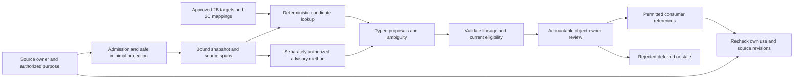
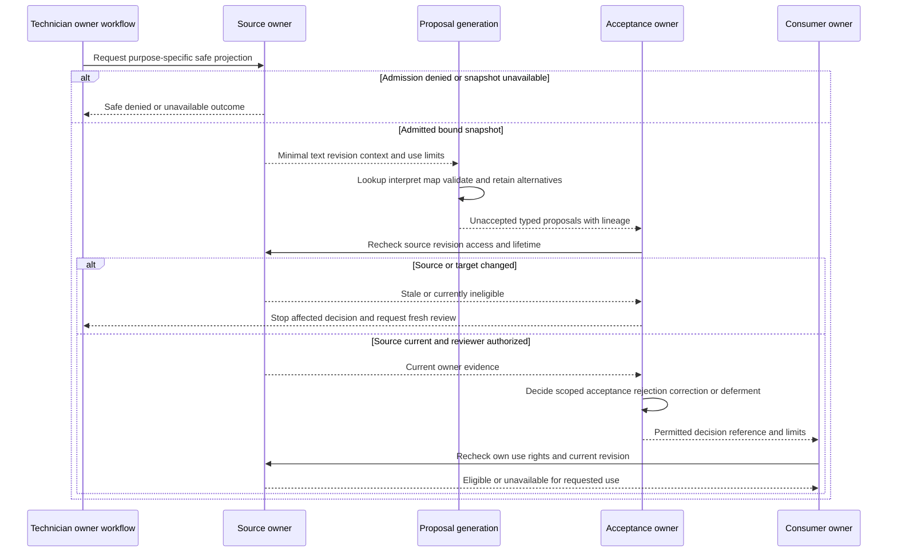

# SemanticModel 2D — Case Note Semantic Extraction Pipeline

## 1. Document Control

| Field | Value |
| --- | --- |
| Phase / mode | SemanticModel 2D; authorized architecture authoring only |
| Date | 2026-10-13 (America/Toronto) |
| Planning status / result | READY_FOR_REVIEW / **2D READY_FOR_REVIEW** |
| Approval / implementation | UNAPPROVED candidate; no runtime implementation |
| Author / independent reviewer | Codex authoring session / separate session pending |
| Baseline / candidate HEAD | `5893c7f518976588d2b6fc9e93c11b180f4d324c` |
| Branch / worktree | `docs/semantic-model-2d-planning` / `C:\Dev\F7Hub-SemanticModel-2D` |
| Repository write allowlist | `Docs/Planning/SemanticModel/2D_Case_Note_Semantic_Extraction_Pipeline.md` only |
| Evidence location | `%LOCALAPPDATA%\F7Hub\CodexCheckpoints\SemanticModel-2D\authoring-20261013\` |
| Candidate identity | External `candidate-manifest.json`; hashes are intentionally outside this document |
| Required sequence | Approved and integrated 2A → 2B → 2C → 2D → 2E → 2F; each task separately authorized |
| Stop gate | Independent architecture review, explicit USER approval, then separately authorized integration; no 2E planning here |

The user directive is preserved by the objective, scope, 26 sections, AC01–AC22 and stop gate below. “MUST” describes the proposed design's obligations; it does not claim implemented enforcement or approval of new 2D decisions. Predecessor constraints are adopted authority. New choices are RECOMMENDATIONS until separately reviewed and approved. No historical predecessor readiness heading is used as current integration status.

## 2. Purpose and Objective

Design how purpose-authorized technician notes and eligible owner projections can yield source-bound troubleshooting interpretation proposals while preserving original content, ownership, truth status and permissions. A useful outcome can be no candidate, several alternatives, a bounded report, an unresolved term or explicit abstention. Extraction is interpretation assistance; accepting an assertion remains a distinct accountable owner decision.

The deliverable is an independently reviewable conceptual design contract, inspection evidence, static validation, a reproducible candidate manifest and reviewer handoff. It selects no physical DTO, SQLite schema, tokenizer, parser, runtime API or component topology. Synthetic snippets below illustrate decisions only; no dataset is generated or altered.

## 3. Authority and Source of Truth

Apply explicit USER requirements → approved architecture → canonical specifications → inspected implementation → executed tests → conventions → inference. FACT identifies current inspected repository/history evidence; ASSUMPTION identifies a bounded premise; INFERENCE identifies a derived conclusion; RECOMMENDATION identifies a proposed 2D decision; NOT VERIFIED identifies missing evidence. Tests were inspected as source, not executed as runtime proof.

| Authority | Inspected owner / controlling meaning |
| --- | --- |
| [Root guidance](../../../AGENTS.md), [ROOT](../../../ROOT.md), [documentation router](../../19_DocumentationIndex.md), [Planning guidance](../AGENTS.md) | Scope, source of truth, evidence, preservation and architecture approval |
| [Foundation guidance](../Foundation/AGENTS.md) and [0A](../Foundation/0A_Master_Foundation_Architectural_Contract.md) | Execution Report A/C/L: layers, source ownership, DynamicHub coordination, ticket-optional local Journal; 0A-D1 and 0A-D2 remain controlling |
| [0B](../Foundation/0B_Global_JSON_Contract_Interoperability_Grammar.md) | Execution Report serialization, validation, security and revision rules; scalar/UTF-16/byte units differ; this document creates no wire contract |
| [0C](../Foundation/0C_Taxonomy_Information_Vocabulary.md) | Execution Report Entity Occurrence, normalization, relationships, Provenance & Confidence, source/privacy admission; use substantive execution sections, not earlier template stubs |
| [0D](../Foundation/0D_Settings_Architecture.md), [0E](../Foundation/0E_Foundation_Architecture_Reconciliation.md) | Preferences versus truth/permission; secrets exclusions; reconciled source, offline, Journal and shared-boundary ownership |
| [2A](2A_Semantic_Model_Foundation.md) | Governed connective layer; definition/assertion, origin/method/acceptance, source gates, offline review and downstream order |
| [2B](2B_Troubleshooting_Concept_Relationship_Model.md) | 28 role keys; P0–P8 and P01–P09; causal acceptance, definition/instance distinctions, validation/resolution and generalization boundaries; corrected F-01 |
| [2C](2C_Troubleshooting_Lexical_Model.md) | Approved-target prerequisite, expression/mapping separation, qualified EN/FR equivalence, search-only comparison, zero/one/multiple candidates and seven independent tasks |
| [Clipboard guidance](../Clipboard/AGENTS.md), [1A](../Clipboard/1A_Clipboard_Domain_Data_Lifecycle.md), [1C](../Clipboard/1C_PySide6_Clipboard_Center.md) | Source admission, Item/Event distinction, scalar spans, privacy/retention/promotion and presentation/recognition boundaries |
| [System architecture](../../06_SystemArchitecture.md), [Python architecture](../../13_PythonArchitecture.md), [PowerShell architecture](../../12_PowerShellArchitecture.md), [PowerShell guidance](../../../PowerShell/AGENTS.md) | Existing service/repository/gateway ownership and execution/result authority; no new process channel |
| [Features](../../03_Features.md), [workflows](../../04_UserWorkflows.md), migrations and sources in §4 | Intended owner workflows versus actual available implementation |
| [S0 research lifecycle](Research/SYNTHETIC_DATA_LIFECYCLE.md), [coverage gaps](Research/PRIORITY_COVERAGE_GAP_REPORT.md), [research plan](Research/CODEX_RESEARCH_AND_DATASET_PLAN.md), imported starter material | Non-authoritative design input. Artifact-valid, imported, synthetic and bilingual labels confer no operational truth or permissions |
| [Delivery skill](../../../.agents/skills/vertical-slice-delivery/SKILL.md) | Baseline, identity, external evidence, independent review and continuity; USER-authorized architecture authoring specializes inspection-only PLAN |

Fresh prerequisite verification at the pinned baseline:

| Phase | Approval/review record freshly inspected | Integrated identity | Current document blob (unchanged since merge) |
| --- | --- | --- | --- |
| 2A | [PR #85](https://github.com/JDecelles1990/F7Hub/pull/85): APPROVED_WITH_NOTES; exact reviewed candidate integrated | `8b92fd13dfe340563044acd41ef15c0b905243db` | `1b8bfd772861b15bb00340768f4dd69795ed389f` |
| 2B | [PR #86](https://github.com/JDecelles1990/F7Hub/pull/86): USER architecture approval; F-01 correction and independent rereview recorded; 29/29 criteria | `3bfe27729e3a7027006b99dca4d7addfcaa5c889` | `52209fb9e8b3329c1b4fa3285bdc454448baf473` |
| 2C | [PR #87](https://github.com/JDecelles1990/F7Hub/pull/87): independent APPROVE WITH NOTES and USER approval recorded; 32/32 criteria | `ae838de651127694c3003fad981b5a649b40f26c` | `08755ae403da92c37a9ff8efe8840cc9ceb98f12` |

FACT: fresh fetch, live `refs/heads/main`, canonical HEAD and `origin/main` agree at the baseline; each merge is an ancestor, has the expected parents and adds its single document. GitHub PR bodies record external review/USER approval; GitHub `reviews` arrays are empty, so this is not a claim of a GitHub-native approving review. Foundation approval/reconciliation is also recorded in its execution reports and merged PR #66/#67/#68/#70/#71 history. Normalized filenames are current; old names in historical records remain history.

Carry-forward: 2A's nonblocking downstream-order note is explicitly satisfied above. 2B F-01 remains closed: only `accepted_cause_of`, with orthogonal accepted `ROOT_CAUSE` / `CONTRIBUTING_CAUSE` roles. 2C F-2C-01 remains OPEN/NONBLOCKING, documentation type, predecessor-owner follow-up: a 0C provenance link lands on a duplicate stub rather than its substantive execution section. 2D refers to the whole owner file and names the intended section; no predecessor repair is authorized. The unrelated 0E AltF7Hub opacity note remains outside this phase; no AltF7Hub content is inspected or resolved.

## 4. Repository Inspection / Reuse Assessment

FACTs below are bounded source inspection at the baseline. REUSE means retain the existing owner, not invoke it in this task or assume a new extraction interface already exists.

| Evidence / current responsibility | Treatment / 2D consequence | Limit / future dependency |
| --- | --- | --- |
| [TicketService](../../../Python/f7hub/services/ticket_service.py), `add_note`, [TicketRepository](../../../Python/f7hub/repositories/ticket_repository.py), `TicketNoteRecord` / coherent `TicketDetailsRecord`, [0004](../../../Database/Migrations/0004_tickets.sql) | REUSE Ticket notes/activity/lifecycle. Note fields include ID, text, type, author, source, AI flag and timestamps; adding a note atomically appends activity. Snapshot binds stored owner text after owner-side trimming, not an editor buffer or combined timeline | `updated_at` exists but no extraction admission or immutable note-version guarantee is established. Timestamp presence alone is not a collision-free revision protocol |
| [KnowledgeService](../../../Python/f7hub/services/knowledge_service.py), [KnowledgeRepository](../../../Python/f7hub/repositories/knowledge_repository.py), [0005](../../../Database/Migrations/0005_knowledge.sql) | REUSE publication/content versions and guarded metadata changes. Body validation retains input; title/summary normalization differs. Bind exact field/version plus relevant visibility/metadata context | Content `version_number` is distinct from `updated_at` metadata and publication state; an old content version is not fresh access authorization |
| [Knowledge FTS](../../../Database/Migrations/0006_knowledge_search.sql), `search_articles` and `_literal_fts_query` in KnowledgeService | REUSE current article-text search and filters. Search matches identify retrieval relevance only | No universal semantic search/extraction index established; FTS token positions cannot be treated as original spans |
| [Diagnostic result types](../../../Python/f7hub/domain/diagnostic_results.py), [PowerShellService](../../../Python/f7hub/services/powershell_service.py) | REUSE producer-owned operation/run/result distinctions. Execution classification, collection status and cleanup are separate | Existing results are in-memory values, not a durable run-history source; a stable authorized producer snapshot/reference needs owner design |
| [ClipboardService](../../../Python/f7hub/services/clipboard_service.py), [Clipboard domain](../../../Python/f7hub/domain/clipboard.py), [0013](../../../Database/Migrations/0013_clipboard_items_capture_events.sql) | REUSE Item/Event identity, retention and safe Recent read. Recent has Item revision, sanitized/truncated preview and limited sensitivity eligibility | Recent is not a raw-source/extraction grant. Its replaced control characters and truncated preview cannot stand in for full original source. Clipboard 1A already specifies zero-based half-open Unicode scalar spans |
| [CategoryRepository](../../../Python/f7hub/repositories/category_repository.py), [TagRepository](../../../Python/f7hub/repositories/tag_repository.py), [0002](../../../Database/Migrations/0002_taxonomy.sql) | REUSE scoped Categories and flat global Tag identity; reference approved entries only | Names/source slugs do not establish mapping approval. Recognition or suggestion never assigns a Tag or creates an Entity |
| [SettingsService](../../../Python/f7hub/services/settings_service.py), [Settings domain](../../../Python/f7hub/domain/settings.py), [0014](../../../Database/Migrations/0014_shared_settings.sql) | REUSE typed preferences and revision-aware Apply/refresh; owning features still authorize effects | Current preference definitions do not provide semantic truth, extraction consent, provider rights or a global policy engine |
| [Ticket workspace](../../../Python/f7hub/gui/ticket_workspace.py), `toPlainText`/`setPlainText`, [task runner](../../../Python/f7hub/gui/service_task_runner.py) | REUSE owner GUI/service separation and finite work. Formatted notes history joins labels and notes with inserted text | A cursor in the composed history is not a stored-note span. GUI highlighting needs explicit scalar-to-Qt/document mapping; no UI change selected |
| [Ticket activity tests](../../../Tests/Database/test_ticket_activity_service.py), [Knowledge tests](../../../Tests/Database/test_knowledge_service.py), [Clipboard tests](../../../Tests/Database/test_clipboard_service.py), [Settings tests](../../../Tests/Database/test_settings_backend.py) | Source inspection supports existing owner intent; REUSE appropriate future tests | NOT RUN; no prior counts presented as fresh 2D tests |
| Tracked filenames/content in Python, Database, Tests, Data/SemanticModel and Tools/SemanticModel | No tracked SemanticModel extraction runtime, general Journal or DynamicHub implementation established in these bounded searches | Architecture ownership survives absence. New source admission/snapshot/review mechanics are dependencies, not permission to implement them here |
| [Starter validator](../../../Tools/SemanticModel/validate_starter.py), [proposal graph](../../../Data/SemanticModel/Proposals/priority_rca_graph.proposed.json), S0 report outside repository | Research/proposal input only; do not import or repair. Starter validator references package-style paths; shape validation would not prove governance | NOT RUN; unknown licenses, target identities, source permissions, methods and product-specific criteria cannot be filled from catalog labels |

S0 G06/G07 route source-bound extraction/provenance to 2D; G08/G09 route corpus/reproducibility to 2E; G11 routes case-to-Knowledge review to its owners/2F; G12 source policy remains source/security-owned. S0's synthetic channel declarations are not independently certified privacy or truth. No operational database is opened, catalog row verified, imported corpus executed or synthetic artifact rewritten.

## 5. Scope and Exclusions

In scope: eligibility, conceptual snapshots/spans, stages, interpretation proposals, bilingual ambiguity, method provenance, owner review, invalidation/failure, privacy/offline boundaries, conceptual consumers, 2E/2F obligations and registers.

Excluded: all extraction runtime; schemas, migrations, repositories, services, DTOs, IPC, GUI, parsers/tokenizers, embeddings/vector indexes, AI agents, lookup APIs and handlers; production imports; dataset generation/alteration; predecessor/Foundation/canonical/source/test edits; new dependencies; execution or owner-record mutation; 2E, 2F and S001 work. Staging, commit, push, PR and merge are explicitly excluded.

Database impact: no physical design or persistence change; no database-validity claim. Documentation impact: this one new owner candidate only. Later approved implementation must assess canonical owner impacts through the router; current status/changelog cleanup is not authorized. Security impact: proposed gate specialization within existing authority, no authentication, credential or shared-security redesign.

## 6. Architectural Invariants

1. Source owner authorizes purpose, projection, lifetime and every stronger use; presence or visibility alone authorizes none.
2. Processing admission precedes text interpretation. Snapshot binding and secret-safe projection precede any method receiving text.
3. Original owner content and producer outcomes remain unchanged. Comparison text, translated text and proposal meaning remain derived and attributable.
4. SemanticModel owns feature interpretation profiles/proposals; source, case, method, taxonomy, publication and execution owners retain their decisions.
5. Definitions, reports, observations, findings, evidence associations, hypotheses, accepted causes, attempts, results, validation and resolution retain 2B distinctions.
6. Exact approved lexical lookup is deterministic candidate generation; it still accepts no case assertion. Fuzzy/ML/AI output is separately marked advisory.
7. ZERO/ONE/MULTIPLE candidates and abstention are valid. No required field forces a fabricated target, cause, activity, validation or resolution.
8. Processing, persistence, indexing, disclosure, Analytics and promotion/generalization are separately admitted uses; acceptance does not bundle them.
9. No automatic Root Cause acceptance, Tag assignment, canonical Entity creation, diagnostic execution, Knowledge publication or Ticket transition.
10. Origin, method, dependence, uncertainty, acceptance and current eligibility stay separate. Copies/translations are not independent corroboration.
11. Revisions and permissions are rechecked at review, acceptance and each downstream use; historical acceptance is not fresh verification.
12. Local deterministic interpretation and owner review remain architecturally possible offline; all optional model/provider paths fail safely.

## 7. Source Eligibility Matrix

RECOMMENDATION 2D-D01: an owning workflow supplies an admission decision for a named purpose, actor, source, target/context, permitted method and bounded projection. This is conceptual evidence of authorization, not a new shared permission token/service. Scope changes require new owner admission; an extraction preference or current active Ticket cannot retarget work.

The matrix describes conditional eligibility, not available runtime interfaces. Each family requires both source-use authority and relevant target-owner authority. No automatic harvesting of all notes, activity, files, Clipboard history or Search results is permitted.

| Family / authoritative owner | Type and purpose / actor-workflow admission | Required reference, revision and minimal projection | Privacy / separate-use rules | Denied/unavailable outcome / downstream owner review |
| --- | --- | --- | --- | --- |
| Ticket-owned note / Ticket | Selected INTERNAL/PUBLIC/WORKLOG/RESOLUTION note for explicit case interpretation by an authorized technician workflow; note type alone is no grant | Local/provider-qualified Ticket and note identities; stored `note_text` field and coherent owner revision/context; only selected text plus separately admitted attribution/qualifiers | Preserve human/import/AI provenance. PUBLIC does not mean public internet or AI permission. Separate processing, proposal retention, case indexing, disclosure and reusable promotion | No candidate on missing authority/source/version support. Ticket reviews case association/assertion; source/integration owner preserves official external note authority |
| Ticket subject/description/activity / Ticket | Selected concern description or textual activity field needed for named case interpretation; history read does not admit all fields | Owner record/activity reference and field, relevant revision/target scope; exclude unrelated metadata/whole `metadata_json` dumps | Keep status history factual under Ticket rules; state RESOLVED/CLOSED is not causal/technical semantic evidence | Missing field, revision or grant makes that projection unavailable. Ticket reviews any proposed annotation; no extraction edits or lifecycle transitions |
| Ticket-optional Journal / Case Journal | Future locally owned selected working note/draft/report in an authorized Journal workflow, with explicit Ticket reference or explicit none | Journal record/source field, owner revision and case-context binding; do not substitute Ticket ID for Journal identity | Distinct local draft versus official PSA publication. No external PSA/AI required for local work. Retention and broader reuse separately granted | Admission BLOCKED for actual processing until owner interfaces exist. Journal reviews its assertions; optional Ticket association separately admitted through Ticket |
| Diagnostic producer / Diagnostics and operation owner | Selected already-produced permitted observation/result field for interpretation; never collect or run merely to fill missing material | Bound operation/run or owner-held ephemeral snapshot, producer profile/revision, actual coverage/collection status; declared textual field or deterministic approved rendering of typed values | Do not ingest stdout/stderr dumps or credentials. Rendered units/labels need projection provenance. Producer availability and invocation permission are distinct from use admission | Missing stable run/source, invalid collection or unknown effect gives unavailable/limited proposal, not negative finding. Producer reviews result meaning; case owner reviews relevance |
| Knowledge article/version / Knowledge | Accessible selected article passage for semantic reference or candidate generalization review, by admitted Knowledge/source workflow | Article/version identity and exact body/title/summary field; content version plus applicable access/publication context; selected passage with admitted context | PUBLISHED is not unlimited extraction/index/disclosure/license permission. Restricted or archived history remains owner-controlled; Markdown rendering is derived | Inaccessible version/reference abstains without revealing text/title/existence. Knowledge reviews content use/publication; semantic curator separately reviews definitions |
| Clipboard / Clipboard | Explicit eligible selected Item projection, or separately admitted transient capture source, for a specified interpretation purpose; no history polling | Clipboard-qualified Item revision and selected field/snapshot; relevant Capture Event only for occurrence attribution; no Item/Event collapse. Recent preview is a different projection | Capture, saved/pinned state, PERMITTED Recent sensitivity or Settings enablement does not admit extraction. Privacy, expiry/holds and source rights checked first; secret material excluded | Deny or report unavailable without echoing content. Clipboard admits source use/retention; case owner reviews assertion; durable promotion requires explicit target-owned admission |
| Imported/public research / import and source-rights owner | Selected licensed/approved source artifact for research or definition proposal only, with authorized research purpose | Artifact namespace/source ID, version/content revision, field and transformation lineage; bounded cited excerpt | Import validity does not certify license/privacy/truth. Synthetic and operational provenance cannot mix; source-specific retention/index/disclosure/training permissions remain independent | Unknown rights/source revision fails closed for processing/use. Source-rights and semantic/Knowledge owners separately review intended adoption |
| Synthetic/AI-generated research / development corpus owner | Declared fictional snippet for separately authorized evaluation/research; generator text remains untrusted | Corpus/scenario family/revision/source field and generation method; explicit synthetic origin; no operational Ticket identity | Fictional observations are not collected production evidence; generated expected outcomes are not evaluation results. No training/disclosure permission inferred | Keep in research context only. 2E later defines reviewed fixture expectations; semantic curator reviews proposed meanings, never accepts fictional case as operational truth |

Admission dimensions apply independently to every row:

| Use | Required decision / safe default |
| --- | --- |
| Processing | Source/target purpose, actor authority, method, minimal projection, bounds and policy checked before method access; deny if required facts unknown |
| Persistence | Explicit proposal/metadata/content retention purpose and lifetime; otherwise transient only. Derived labels/rationales/maps can be sensitive too |
| Indexing | Search owner and source policy admit fields, audience, query purpose, invalidation and retention; retention alone is not indexing permission |
| Disclosure | Independently admitted recipient, local viewer/export/provider destination and projection; safe reference metadata may still require authorization |
| Promotion / generalization | Source rights for target use plus receiving owner review of meaning/content/visibility/lifetime; neither source acceptance nor copying expands rights |
| Analytics | Separate eligible population/grain/time/provenance and privacy review; no automatic raw-note feed or synthetic-as-operational counts |

Unavailable and denied are distinct internal reasons; external feedback is minimized where disclosing that distinction would reveal protected existence. Source owners may screen content while forming a safe projection; this is not an exemption allowing an extraction method to inspect disallowed raw text. Unknown sensitivity/secret-safety or employer policy is NOT VERIFIED and denies the affected processing path until the owner resolves it.

## 8. Source Snapshot and Span Model

RECOMMENDATION 2D-D02: a snapshot is the exact authorized immutable text view used by one interpretation generation, bound to its source owner/namespace, record and field/projection, source revision, projection profile/revision, admitted context/purpose and policy/permission context. It is a conceptual identity and lifetime requirement, not a stored copy, hash ID, DTO or mandatory snapshot table.

The owner supplies text and revision coherently, including projection/context needed to interpret it. Owner revision tokens remain opaque at their original precision; assembly time is not a source revision. No assumption that timestamps uniquely identify edits, that IDs are globally unique, or that an ephemeral source can be reread indefinitely. Where coherent revision/current-authority checks cannot be established, the source family is unavailable for fresh acceptance/use. A permitted local draft may still be reviewed manually through its owner without claiming reproducible extraction.

“Original” below means the owner-admitted source text for this snapshot, exactly as supplied before comparison transforms. It may already be an owner-redacted derivative. The ultimate source and every authorized transformation remain attributable; a derivative must not be labeled the unredacted original. Stored Ticket trimming is upstream owner behavior; 2D preserves stored text, with no claim to reconstruct what was typed before save. Concatenated fields are not silently one original: each segment retains source field/revision and an explicit projection map; inserted headings/separators are synthetic text with no source occurrence authority.

### Coordinate convention and original fidelity

RECOMMENDATION 2D-D03: reuse Clipboard 1A's Unicode scalar-value convention. Call it the **2D scalar-span convention, revision 1** for conceptual version attribution; this is not a new global wire/profile registry or deployed enum. For admitted well-formed Unicode text, code-point indexing restricted to non-surrogates equals scalar indexing.

| Rule | Contract |
| --- | --- |
| Units / origin | Zero-based Unicode scalar indices in the exact bound original snapshot field; not UTF-8 bytes, UTF-16 code units, graphemes, tokens, screen columns or FTS offsets |
| Bounds | Half-open `[start,end)`; `0 <= start < end <= N`, where N is scalar count of that snapshot; selected original slice must correspond to the proposal. Empty span is not a textual occurrence |
| Evidence envelope | Lexical mention span and separately admitted bounded context spans can differ: negation, reported speech and conditions outside the mention must remain dependencies. Do not discard qualifiers to simplify a span |
| Repetition / overlap | Identical wording at different spans is different occurrences. Nested/overlapping spans are allowed and preserve roles/methods/parent context where meaningful; do not choose longest match as semantic authority |
| Duplicate output | Same source snapshot, span, role/target, context and method assessment can be grouped for presentation with origins retained. Different sources/methods or contradictory roles remain distinguishable; deduplication is not corroboration |
| Unicode / languages | Emoji/supplementary characters count one scalar; combining marks count individually. EN/FR/mixed text, accents, curly punctuation and bidirectional/control characters retain their source representation if admitted; language is per relevant segment, including undetermined |
| Malformed input | Reject unpaired surrogates/invalid source decoding before span claims. Do not silently replacement-decode and pretend offsets address the source; an owner-approved repaired derivative needs new projection identity/lineage |
| CRLF / LF | Exact source retains its line endings: CRLF counts two scalars, LF one. No platform newline translation in snapshot/span calculations. A source line-ending change is a different revision/projection, even if wording is similar |
| Highlighting | GUI converts scalar boundaries through the actual presented projection/document to Qt positions; never apply source indices directly to cursor/UTF-16 positions. Grapheme-safe display expansion is presentation-only and preserves the underlying semantic span |
| Bounded reference alternative | Where text/spans cannot be retained/disclosed, use an authorized bounded owner reference with field/revision/context. It supports traceable review only through fresh permitted owner access; it supplies no guessed offset or hidden copy |

Python `str` is a sequence of Unicode code points; Qt cursor positions index 16-bit QChar units rather than graphemes. These official facts support the conversion boundary, not a runtime conversion implementation. [Python text sequence documentation](https://docs.python.org/3/library/stdtypes.html#text-sequence-type-str), [Qt QTextCursor position](https://doc.qt.io/qt-6/qtextcursor.html#position). Existing Python Clipboard preview scalar validation fits the proposed convention. SQLite text presence/length and Qt editor state do not themselves provide a snapshot/map.

### Comparison transformations and mapping

RECOMMENDATION 2D-D04: original and comparison text are separate. Any admitted case/whitespace/Unicode/accent/punctuation/line-ending transformation names its producing profile/revision, ordering, applicability, purpose, actual operations and limits. Under 2C, comparison is search/discovery only; normalized equality cannot create an approved exact alias or semantic/canonical identity. No default NFC/NFKC, accent fold, casefold or trimming is selected here.

For each comparison detection, the method must supply a validated correspondence to original scalar intervals in the bound snapshot. Correspondence may be one-to-many or many-to-one; transformed offsets are never reused as original offsets. Each contributing original interval is nonempty, bounded and attributed; original contributing intervals are ordered, non-overlapping within one detection and may be discontiguous. Inserted comparison material has no original interval and cannot alone justify an occurrence. A deleted region, expanded character or reordered combining sequence cannot be hidden inside a falsely exact source slice.

When correspondence yields one exact contiguous original region, use that original span and separately preserve transformation provenance. Otherwise preserve the ordered contributing spans with an explicitly broader context envelope if authorized; label the envelope as context, not an exact contiguous lexical occurrence. If the method cannot validate correspondence at that granularity, abstain from a located occurrence and offer only an authorized bounded-reference proposal. A broader envelope never authorizes omitted/redacted content or asserts that transformed wording appears verbatim in it. Map representation/algorithm/library and renderer conversion remain deferred; transformations lacking this property are ineligible for located proposals.

Synthetic illustration (escaped strings, not fixture data): original `é🔧\r\nVPN` has seven scalars; `VPN` is `[4,7)`. If an admitted comparison view folds CRLF to LF, its `VPN` range `[3,6)` maps to original `[4,7)`. Original `e\u0301` has two scalars; a one-scalar composed comparison cannot reuse its offsets. Original `ß` can expand to two comparison characters; a match of only one expanded character cannot claim an exact verbatim source character. Two `VPN` mentions retain distinct original spans even when comparison text is identical.

### Redaction, lifetime and stale detection

Owner redaction before processing creates a new admitted projection/revision. Removed or masked regions cannot participate in recognition, serve as implicit context or be reconstructed from maps/rationales. A proposal depending on removed context is invalid even if its visible mention survives. New redaction after extraction makes old spans/proposals ineligible for current use; re-extract from the newly admitted snapshot. No automatic span shifting or length-preserving-mask assumption. A mask is not a lexical occurrence; a span across a mask cannot assert continuity through unavailable text.

The snapshot lifetime cannot exceed its current source/purpose rights. Permitted retained metadata/history needs its own policy; otherwise discard transient snapshots/maps/proposals. Source deletion, expiry or permission withdrawal stops access and dependent current use. Explicit approved durable promotion can establish a distinct receiving-owner source/lifetime with preserved origin; it is not automatic retention of the old raw source. A content hash is sensitive derived metadata, is not anonymization, does not grant access and is not a substitute for owner revision or permission. Snapshot hashes are not required by this design.

Stale detection compares current owner source/projection revision, target/context, grants, method/profile and semantic/lexical dependencies against the generation binding. Missing checks mean eligibility unknown/unavailable, not “unchanged.” Equality of text alone cannot establish current authority. §13 determines consumer responsibilities and historical acceptance treatment.

## 9. Extraction Pipeline Contract

RECOMMENDATION 2D-D05: ten conceptual stages; no runtime classes, APIs, tables or scheduler follow. Each method receives only the admitted minimum and returns attributable proposals/limits. A source-specific profile may split, combine or repeat steps, but cannot bypass prerequisite gates or strengthen authority.

| Stage | Input invariant | Output invariant / stop behavior |
| --- | --- | --- |
| 1. Purpose-specific admission | Explicit source/target owner, actor/workflow, use/method and field scope | Permitted projection request or safe denied/unavailable reason; no interpretation of disallowed text |
| 2. Minimal projection and snapshot binding | Owner authorizes access and supplies coherent source/field/revision/context | Exact immutable admitted snapshot plus coordinate/projection lineage and lifetime; insufficient revision/projection support stops fresh processing |
| 3. Privacy filtering and processing constraints | Owner privacy screen precedes method access; bounds/method eligibility available | Final safe projection and admitted purpose. Redaction changes snapshot identity and repeats binding. Unknown secret-safety, policy or bounds failure denies that path |
| 4. Language/context recognition | Safe bound text and admitted limited context | Source segment languages/qualifiers/product/time/reporting scope, including undetermined and alternatives; no translation-as-equivalence |
| 5. Approved lexical lookup and deterministic generation | Current eligible approved targets/mappings, permitted lookup profile and applicability | Traceable lexical candidates, exact/scoped versus discovery explanation, zero/one/multiple outcomes and validated source correspondence; no installed catalog assumed |
| 6. Role/concept interpretation | Candidate wording with polarity/modality/reporter/temporality/context and full relevant qualifier dependencies | Proposed 2B role interpretation(s), unresolved/abstained meaning and rationale; definitions do not become case occurrences automatically |
| 7. Typed occurrence/relationship proposals | Role candidates with owner-qualified endpoints, scope/revisions and method provenance | Source-bound occurrences or typed relationship proposals conforming to §11; unresolved endpoint remains visibly unresolved, never fabricated canonical identity |
| 8. Validation and ambiguity classification | Proposed spans/maps, endpoints, source and mapping authority, qualifiers/dependencies | Well-formed proposals plus limits, contradictions/alternatives and current eligibility; malformed component discarded safely; incomplete generation cannot claim completeness |
| 9. Owner-directed human review | Current access/revision checked; eligible source/proposals and accountable decision owner available | Accepted/rejected/corrected/deferred owner decisions for stated object/use/revision only; no generating method self-acceptance |
| 10. Permitted handoff and reassessment | Consumer rechecks required source/target rights and revisions plus its own use grant | Eligible bounded references/projections with review/history limits, or unavailable/stale response; stronger effects route through their independent owners |

Stages 1–3 are mandatory prerequisites to any text method, including local AI. Privacy checks may happen in the owner while building stage 2 and repeat at every outbound/persistence boundary. Binding after a filter is repeated before stage 4. Language/context recognition and deterministic lookup may iterate because a term suggests several contexts, without widening admission. Stages 6–8 may produce partial proposals or repeat validation; stage 9 may send corrected interpretations back through relevant checks. Stage 10 never skips owner review for uses requiring accepted assertions. Manual owner review can proceed without a model/recognizer; it is labeled manual, not extracted output.

Fuzzy/typo discovery and separately authorized local/remote ML/AI may add advisory alternatives after admission. They do not replace the deterministic approved-lookup lane, silently supply missing approved mappings, overwrite deterministic provenance or transfer their score to RCA/Entity/Tag decisions. No parser/model output becomes a new processing instruction, catalog approval, remote request or execution. A producer must distinguish no match from method unavailable, not evaluated, bounds-limited, cancelled or failed.

## 10. Bilingual and Ambiguity Semantics

RECOMMENDATION 2D-D06: inherit 2C stable language-neutral targets and independently reviewed expressions/mappings. An approved 2C document does not approve every lexical candidate in its matrices; French LANGUAGE_REVIEW_UNRESOLVED entries and imported product names remain candidates. Preferred Concern wording does not rename `troubleshooting_issue_definition` or Ticket PROBLEM.

| Source feature | Required interpretation / explicit abstention |
| --- | --- |
| EN, FR or mixed text | Preserve actual language at the relevant spans. A language preference affects display only. Keep mixed or undetermined attribution; no forced translation or assumed French approval |
| Abbreviation / product shorthand | Use only an eligible directly reviewed mapping in its declared product/version/namespace/time context. MFA, VPN, Outlook, Entra or M365 alone can remain multiple/unmapped targets |
| Ambiguous word / multiple aliases | Preserve competing targets/roles and missing context. Highest score, familiar product, first catalog row or phrase frequency cannot choose semantic identity |
| Negation | Bind negation scope and qualifier span to the mention: “VPN not failing” proposes a negated report, not a positive symptom; uncertain negation scope abstains from asserted polarity |
| Conditional / planned statement | “If it fails, restart” records a condition and proposed/planned action, not observed failure or completed attempt. Conditional causality remains hypothetical |
| Reported speech | “Customer says it works” is a reported claim with speaker attribution; no fabricated direct observation/technical validation. Nested or unknown speaker scope stays unresolved |
| Temporal phrasing | Retain reported event time/order separately from note order, collection, invocation and acceptance time. “After restart” is no causal link; unclear ordering stays uncertain |
| Typo / accent / normalized match | Identify search-only comparison or advisory typo proximity. Similar wording/translation is no reviewed equivalence; a repaired spelling is not inserted into the original |
| Unknown / unmapped term | Preserve a bounded source-local proposal or no match; do not invent a canonical key, English/French synonym, cause or new catalog entry |
| Conflicting qualifiers | Keep alternatives/contradictions and scope differences; no silent majority vote or adjective removal to force a role |

Abstention is a positive safe behavior with a bounded reason: missing mapping approval, context, source eligibility, coordinates, polarity, method criteria or owner evidence. It may be partial: retain a clearly attributed symptom report while abstaining from cause or resolution. Explain alternatives only to an authorized viewer; ambiguity metadata itself can reveal sensitive targets. Search-only cues stay discovery-only even when the mention occurs in a case note.

## 11. Concept and Relationship Proposal Profiles

The following is a compatibility crosswalk to 2B, not new role definitions or physical discriminators. All 28 keys remain unchanged. No requirement creates one record/class for every role.

| Existing 2B keys | Permitted extraction interpretation / stronger boundary |
| --- | --- |
| `troubleshooting_issue_definition`, `symptom_definition`, `symptom_report` | Match reusable concern/symptom candidates; source-attributed report is distinct from definition and verified technical truth |
| `observation`, `finding`, `evidence`, `claim` | Propose source statement, criteria-bearing interpretation or claim-specific evidence association separately. Finding requires actual admitted inputs/method criteria; evidence requires named claim/revision and owner acceptance |
| `cause_definition`, `cause_hypothesis`, `accepted_causal_claim`, `contributing_cause`, `root_cause` | Propose possible explanation/claim or recognize a bounded reference to an existing owner acceptance. “Root cause was X” alone is a source-reported causal assertion awaiting review, not an accepted causal claim |
| `diagnostic_step_definition`, `diagnostic_attempt`, `check`, `test` | Distinguish method reference, plan and attributed attempted use. Check/Test are method roles; neither implies execution/read-only effect. No run reference fabricated |
| `action_definition`, `action_attempt`, `intervention`, `remediation`, `recommendation` | Preserve advice/intent, attempted activity and effect roles. “Tried restart, still broken” can propose unsuccessful reported attempt; actual authorized execution requires independent owner evidence |
| `result`, `validation_definition`, `validation_assertion`, `resolution`, `mitigation`, `recurrence`, `escalation` | Producer outcome, criteria, actual evaluation and accepted treatment stay distinct. Partial mitigation, unknown cause, recurrence and an unreceived escalation request remain representable |

A note that quotes a result is a statement about that result; resolving an accessible producer reference can corroborate it only through permitted owner access. A result's SUCCESS/ERROR is not a universal health or validation outcome. Failure to collect provides no negative observation. A plan is no attempt, a reported attempt is no proven authorized execution, and absence of mentioned activity is not evidence it never occurred.

Every relationship proposal inherits 2B P0–P8: exact identity/status, provenance, typed applicability, optional cardinality/association identity, distinct authority, method uncertainty, history/deletion, privacy and misuse constraints. All nine predicates remain directed, non-symmetric, non-transitive. Unresolved endpoints block assertion of an accepted edge; no label or sequence fills them.

| Existing predicate | Endpoint level / admissible proposal | Acceptance boundary |
| --- | --- | --- |
| `has_symptom` | Concern Definition → Symptom Definition; reusable association proposal only | Semantic curator; no Ticket symptom from Category/Tag |
| `possible_cause_of` | Cause Definition → explicitly typed Symptom/Concern Definition; conditioned reusable possibility | Semantic curator after technical/source review; case hypothesis uses owner references, not this definition edge as case proof |
| `investigated_by` | Symptom/Concern/Cause Definition → Diagnostic Step Definition; relevance proposal | Semantic relevance and Diagnostics method/criteria review; no executed attempt implied |
| `supports_claim` | Admitted source/Observation/Finding/Result → scoped Claim | Source-use admission plus claim owner association review; support does not accept claim |
| `contradicts_claim` | Same admitted material union → scoped Claim | Claim owner reviews scoped conflict; access denial or no collection cannot contradict technical condition |
| `informs_claim` | Same admitted material union → scoped Claim | Explicit relevance/inconclusive-direction rationale, not an arbitrary relatedness bucket |
| `accepted_cause_of` | Owner-accepted case causal Claim → bound case concern/Symptom Occurrence | Extraction never emits an accepted edge from wording. It may propose causal-review input or reference an already verified owner acceptance with its scope/revision; only case owner accepts this sole case causal predicate |
| `candidate_remediation_for` | Remediation-intent Action Definition → Cause/Concern Definition | Semantic suitability with action/resource-owner review; no invocation, guarantee or Resolution |
| `validation_method_for` | Validation Definition → Action Definition with intended conditions | Semantic relevance plus criteria owner review; relevance is not requiredness, actual evaluation or PASS |

`ROOT_CAUSE` and `CONTRIBUTING_CAUSE` are separately owner-designated roles on accepted causal claims, not alternate edges. `contributes_to` remains inactive/explanatory; source wording “contributes to” creates neither role nor machine alias. Zero accepted causes, several hypotheses, mixed support/contradiction, multiple accepted causes with explicit joint scope, ineffective repairs and unresolved cases are valid. No transitive causal closure, majority evidence count, automatic generalization or synthetic prevalence inference is permitted.

Case causal acceptance applies all six 2B criteria: scoped proposition; eligible support and mechanism; contradictions/gaps/dependent evidence; competing explanations; source validity/diagnostic relevance; accountable actor/time/revision/rationale/limits. Root Cause designation adds depth/scope rationale. No score or extraction success satisfies these for the owner.

Validation requires actual eligible observations evaluated against declared criteria/coverage/window. Resolution requires explicit case acceptance of treatment/mitigation, necessary validation or an existing approved owner reason for inapplicability, remaining impact and limits. Customer confirmation, “fixed,” successful invocation, later silence or Ticket RESOLVED/CLOSED alone supplies neither technical validation nor causal acceptance. A resolved/mitigated case may have unknown cause; a known cause may remain unresolved. Case acceptance creates only a candidate for broader reuse, followed by separate semantic/source/Knowledge review.

## 12. Provenance and Human Review

RECOMMENDATION 2D-D07: minimum conceptual proposal information below, subject to purpose-specific minimization. “Required” means the fact/reference must be established where applicable; it does not require persisting sensitive material or inventing unavailable values.

| Information | Required interpretation |
| --- | --- |
| Source identity | Source owner/namespace, record and field/projection, revision/snapshot/context and source origin; Ticket, Journal, Clipboard, import, synthetic and AI stay distinguishable |
| Source support | Valid original span(s) plus qualifier dependencies, or authorized bounded reference; no hidden raw excerpt in rationale/log/map |
| Producing method | Deterministic approved lookup, rule/parser, manual correction, fuzzy/ML/AI advisory lane; method/profile revision and source generation binding |
| Meaning dependencies | Role, semantic target owner/key/version, lexical mapping/profile revision and approval/permitted-use evidence; missing canonical target expressly unresolved |
| Candidate proposition | Typed occurrence or directed relationship with source/target roles, case/definition level, scope/time/subject/product/context and intended use |
| Rationale / uncertainty | Bounded interpretable basis, alternatives, negation/modality/reporting/temporal limits, method-specific assessment and missing-versus-zero distinction; no invented deterministic 1.0 |
| Dependencies | Other candidates, source context, producer/criteria references, copies/translations and joint interpretations; unresolved or stale dependency propagates only to affected conclusions |
| Review responsibility | Intended source-use, case/assertion, semantic/lexical, producer/criteria and receiving publication owner as applicable; actual actor authority separately checked |
| Review / current eligibility | Decision purpose, reviewed revision, actor/time/reason and limits where permitted; present source/target eligibility and challenged/stale status separately recorded |

Proposal generation, human examination, owner acceptance and downstream-use authorization are four distinct acts. Human review must expose authorized source context and relevant alternatives, not only the suggested label/score. A reviewer cannot approve a source that their current role cannot access, or use semantic curator authority to accept Ticket/Journal/Diagnostics/Knowledge objects. Same technician can act in several scopes, with separate attributable decisions; this defines no new role system or universal reviewer queue.

| Review outcome | Contract |
| --- | --- |
| Accept for stated object/use | Authorized owner checks current source/target/context, proposition, relevant criteria and dependencies, records rationale/revision/limits. Case assertion acceptance is not taxonomy identity or disclosure/publication permission |
| Reject | Scoped reason and reviewed proposal revision retained only where allowed; no global disproof or destructive source edit; generating method cannot silently resubmit as accepted |
| Correct | Attributable new interpretation revision; preserve allowed lineage and revalidate affected roles/spans/dependencies. Correction to meaning is not a source edit; owner source editing is a separate workflow requiring new extraction binding |
| Defer / unresolved | Preserve explicit missing evidence/context/authority and eligible alternatives; no acceptance deadline or forced choice; abstention valid |
| Stale during review | Stop affected acceptance/use, preserve permitted draft decision context, request current owner snapshot and re-review; never migrate approval to a new generation automatically |

These are conceptual dispositions, not a global Status enum or installed workflow. Approval of a semantic definition or lexical mapping does not accept an occurrence/evidence association/claim. Historical acceptance retains original AI/import/synthetic origin and method uncertainty. Reviewer identity/authorization is revalidated at the decision boundary; changing reviewer or losing authority does not inherit another actor's uncompleted draft acceptance.

## 13. Revision, Invalidation and Failure Handling

RECOMMENDATION 2D-D08: bind each generation and owner decision to material source, projection, target/context, lexical/semantic and method revisions. Recheck current eligibility before delivering in-flight output, owner acceptance, persistence, indexing, disclosure, Analytics, promotion and later read/use. Checks may reuse an owner-certified current snapshot for a bounded decision where its contract supports that; cached admission alone is never a perpetual grant. Concrete atomicity/version comparison mechanisms remain owner implementation decisions.

| Change / failure | Required current behavior | Permitted history / recovery |
| --- | --- | --- |
| Note edit or source revision change | Old proposals/spans are stale for new text, even if visible phrase is unchanged; no automatic rebasing by substring search | Existing accepted assertion stays attributed to old revision where retention permits; current owner re-review/extraction required |
| Projection/redaction change | Invalidate dependent context and spans; no offset shifting or inference through masks | New admitted derivative with fresh binding; redact/drop previous retained content/maps under policy |
| Deleted/expired source | Stop source access and dependent current replay/review/index/explanation; no secret copy to defeat TTL | Minimal history only with explicit policy. An approved durable promoted source has distinct owner/lifetime; original remains unavailable |
| Permission withdrawal / policy change | Stop affected methods/in-flight delivery and deny stronger use; invalidate/evict affected derived copies/indexes through their owners | Withdrawal is no proof claim was false; allowed acceptance history cannot be described as freshly verified |
| Taxonomy/lexical mapping revision | Recheck target identity, scope, equivalence/discovery role and permission; old mapping is not automatically current | Owner compatibility disposition can preserve meaning with exact review evidence; otherwise re-review affected interpretations |
| Semantic concept supersession/split/merge | No automatic redirect/relabel or inferred target identity | Preserve historical key/revision where admitted; owner semantics review needed for new target |
| Target owner record/context revision | Reject stale case/Ticket/Journal/product binding; active selection changes affect future work only | Re-admit a new target explicitly. Late result remains bound to original invocation context |
| Reviewer changed or authority revoked | Revalidate current decision actor/scope; draft review is not completed acceptance | Completed historical decision remains attributed, subject to owner's current policy; replacement reviewer starts accountable review |
| In-flight stale proposal/dependency | Discard or hold affected delivery/decision as stale; stale failure must not overwrite newer successful generation | Explicit refresh/review of current generation; no automatic replay or retargeting |
| Partial method failure / resource ceiling | Identify evaluated versus not-evaluated portions; valid independent proposals can be shown as partial after gate checks | Failed/bounded dependency cannot support a complete assertion. Retry only by admitted owner action with bounded future policy; no broad harvest |
| Cancellation | Stop further generation/delivery as permitted; no fabricated zero-match/negative condition or cancelled successful owner write | If an owner decision already committed, report it as accepted; later refresh/cancellation concerns a distinct operation. Uncertain outcome checked with owner before retry |
| Source unavailable after historical acceptance | Display permitted historical attribution and source-unavailable/current-verification limit; prohibit unqualified fresh/current-evidence claim | Case owner determines current applicability/review needs using other eligible evidence. No automatic reversal, copying or retention exception |
| Producer/Knowledge reference inaccessible | No dereference, leaked label/existence or fabricated observations; dependent interpretation abstains/unavailable | Owner-directed reauthorization or a permitted alternative source, with separate origin; no substitute selected silently |

Responsibility is explicit: source owner certifies current projection/access/lifetime; extraction owner validates generation/dependencies before output; case/semantic/criteria reviewer rechecks before their acceptance; receiving owner rechecks before persistence/promotion; Search rechecks index admission and result-time visibility plus handles invalidation; Analytics rechecks eligible lineage/population before calculation/disclosure; Mochi/outbound gateway rechecks recipient/method/purpose at send. GUI renders only eligible owner projections and rejects stale generations; it is not the authorization boundary.

When an owner cannot establish a required current check, fail closed for that use with a safe unavailable/stale condition. Source/target invalidation is dependency-scoped, not a global deletion of all meanings. No listener/event bus, scheduler, cascade schema or status machine is mandated. Future slices must demonstrate prevention of stale disclosure during cleanup/revocation races, rather than merely enqueueing eventual invalidation.

## 14. Privacy and Security

Treat all source text, imported labels, model output, references and metadata as untrusted. Processing authorization includes method and environment: saving data in F7Hub does not approve local model processing, embeddings, model caches, training, external prompts or employer/customer disclosure. Unknown policy blocks the affected path; it is not filled by a preference, broad account access or a claimed “sanitized” flag.

Secrets are excluded before ordinary method output, proposal retention, logs, indexing, fixtures and prompts. Redaction/pattern recognition is defense in depth, not certification. Source/outbound owners must admit a safe projection under reviewed policy; when secret-safety is unknown, deny or request a new safe owner projection without echoing the suspect text. No credential retrieval, secret storage, broad tenant grant or new security broker is selected here.

Proposal roles, endpoint links, source names, rationales, offsets, map lengths, hashes, context and acceptance existence can disclose sensitive information. Apply minimization to all of them; do not copy raw context into a seemingly safe metadata field. Hashes are neither anonymous nor access controls. Persistence/indexing/disclosure/training remain independently authorized, including derived data and aggregates. Privacy deletion can remove content and history when required; accountable history is not an unconditional retention exemption.

Prompt injection embedded in a note, article or catalog is data. It cannot change task/system instructions, tool permissions, owner admission, allowed destinations, schema/meaning, method configuration or review/acceptance authority. Advisory methods have no automatic tools/execution/retrieval channel; any separately approved retrieval must independently admit each source. Model-produced URLs, commands, paths, “approval” statements and relationship keys are untrusted candidates, not executable directives or valid owner evidence.

Safe failure messages identify bounded outcome and recovery through the owner, with no raw source, rejected payload, secret, full prompt, command line or confidential title. Technical logging may record safe operation/method revision, generation/correlation identity, stage classification, bounds/cancellation outcome and timings if admitted. Audit decisions remain meaningful owner records, not technical logs. Text-dependent counts and identifiers need privacy review; no unrestricted raw traces by verbosity flag. Resource/time/output limits, cancellation and cleanup policies must be defined by future approved method profiles; no invented thresholds here.

## 15. Offline and Optional AI Boundaries

| Capability | Classification / obligation |
| --- | --- |
| Deterministic approved local lookup, source-bound proposals and manual owner review | LOCAL_REQUIRED architecture; usable with eligible local source/definitions, without remote provider, embeddings or AI |
| Journal storage/drafting and local note review | LOCAL_REQUIRED under 0A-D2; optional Ticket/PSA/AI cannot become a prerequisite |
| Optional authorized local AI/embeddings | Separate source/method/policy admission despite local execution; advisory and disableable. No local engine, weights, storage, model memory or training chosen |
| Remote AI/embedding enhancement | ONLINE_OPTIONAL product capability; independent recipient/permission/minimal-projection admission, approved preview and explicit Send where outbound owner requires it |
| A specifically authorized remote request | ONLINE_REQUIRED for that request; timeout/unavailability/unconfirmed output is explicit and cannot disable local work |

Optional methods may propose alternative interpretation with actual method/profile/model attribution and task uncertainty; they cannot approve mappings, accept their own output, select/exercise arbitrary tools, establish cause, execute Diagnostics or publish Knowledge. No synthetic-count likelihoods, model scores as permission, transferred confidence between tasks, benchmark threshold, vendor/provider selection or training permission is adopted. Existing eligible deterministic/manual paths remain available after optional-method failure; no automatic provider fallback, stronger data disclosure or silent online retry.

If an eligible approved local mapping is unavailable, local review may retain unmapped wording/abstain. Offline support does not justify trusting imported catalog entries, stale authority or guessed data. Fresh operational permissions and available local source still apply; a remote-only source can be unavailable offline without blocking independent local notes.

## 16. Cross-Module Ownership/Handoff Matrix

All handoffs are future conceptual read/reference obligations, not implemented APIs. Receiving a proposal does not authorize execution, storage, indexing or publication.

| Owner / consumer | Authoritative responsibility / possible admitted handoff | Must recheck / must not infer |
| --- | --- | --- |
| Ticket | Notes/activity/lifecycle and existing associations; bounded interpretation proposal/reference | Current Ticket/note/context and case authority; no direct source edits, status/priority/type change or inferred closure |
| Case Journal | Ticket-optional working records, case assertions/review and source associations | Its own source/revision/optional Ticket binding; no competing Ticket Timeline or official PSA publication |
| Knowledge | Article content, history, visibility and publication; eligible definition refs or candidate generalization | Source reuse/license, technical/content review, revision and audience; no automatic publication from accepted case |
| Diagnostics / execution | Methods/criteria, authorized invocation and producer results; eligible interpretation/relevance proposal | Method/run/result validity and current permissions; report is no proven run, invocation or remediation authorization |
| Search | Retrieval/index/ranking/explanations; admitted labels/proposals/current owner refs | Index purpose/retention and result-time access/revision, mapping roles; hit/rank never asserts diagnosis or case truth |
| SemanticModel | Reusable semantic/lexical/predicate profiles and interpretation proposals/review of its own objects | Target/mapping approval/version and source-use rights; never universal workflow, record, execution or Settings engine |
| Taxonomy / domain identity | Category/Tag/Entity meanings and approved identity/assignment workflows; occurrence or Tag suggestion | Owner namespace/context and resolution/assignment authority; recognition neither creates canonical Entity nor assigns Tag |
| Settings | Supported preferences, defaults/overrides/effective values | Owning feature activation/authorization; preferences do not define truth, grant disclosure or disable safety |
| Analytics | Methodology, eligible populations/grain/time and read-derived metrics | Current lineage/privacy and synthetic-versus-operational strata; no raw notes by default, prevalence from fictional counts or operational writes |
| Mochi / AI | Advisory presentation, explanation/drafts; independently eligible minimized context | Viewer/provider/source/method authorization and revisions at delivery/send; no automatic source widening, acceptance or effects |
| DynamicHub | Approved application-level interactive troubleshooting coordination | Explicit bound technician intent and owner routing; no alternate executor or semantic acceptance authority |
| Integrations | External-system authority, capability/permissions and validated projections | Current provider/source rights and exact record/revision; local draft/report is not confirmed official remote note |

## 17. Mermaid Architecture and Sequence Diagrams

Conceptual arrows describe allowed proposals/references and checks; no runtime components are created. Owner acceptance is explicitly outside the generating method.

## 18. Conceptual Edge-Case Test Matrix

These are architecture-level evaluation implications for 2E, not generated fixtures, runtime tests or benchmark results. “Success” means observable future behavior satisfying the contract; a false positive includes unauthorized output or overstated authority, not merely a wrong label. Located outcomes must meet §8 independently of meaning correctness. All acceptance-requiring outcomes still need accountable owner review.

| ID / synthetic scenario | Observable success / abstention | False positive or prohibited behavior / review requirement |
| --- | --- | --- |
| EC01 Positive symptom wording | Attributed `symptom_report` candidate with span, context and target mapping limits | Direct observation or cause declared from user report; case reviews scope |
| EC02 “VPN is not failing” | Negated report with dependency on negator; ambiguous scope abstains | Positive failing symptom extracted by dropping “not” |
| EC03 “Restarted; still broken” | Reported attempted action and ineffective outcome retained separately | SUCCESS, proven authorized run or Resolution inferred; producer/case corroboration required |
| EC04 “Cause unknown” | Unknown cause; zero accepted causal edges valid | Missing cause filled from catalog/score |
| EC05 “Could be routing or credentials” | Multiple hypotheses with modality; no forced choice | Highest-scoring target accepted as Root Cause |
| EC06 Contradictory observations | Scoped support/contradiction alternatives and collection coverage retained | Conflict suppressed or copied reports counted as independent votes |
| EC07 Ambiguous alias/product | Multiple/unmapped targets with missing context; scoped reviewed mapping only | Broad MFA/Outlook/VPN cue treated as unique concrete identity |
| EC08 EN/FR mixed note | Actual segment languages, original accents and source spans; unresolved French mapping honest | Translation/fallback relabeled reviewed equivalence |
| EC09 Emoji and combining accents | Scalar bounds and original-slice correspondence, separate Qt conversion dependency | UTF-16/grapheme/byte offsets reused as source indices |
| EC10 CRLF versus LF | Different exact source views/revisions; validated comparison-to-original map | Newline fold silently shifts source highlighting |
| EC11 Identical phrase twice | Distinct spans/occurrences with qualifiers per mention | First substring lookup substitutes one occurrence for both |
| EC12 Note edited during review | Old generation rejected as stale; fresh owner binding/re-review | Approval automatically moves to new text because phrase survives |
| EC13 Deleted/expired source | Current use unavailable and derived exposure prevented; admitted history explicitly historical | Hidden retained raw text or fresh-verification label |
| EC14 Permission denied/withdrawn | No method/delivery access; safe feedback without protected existence leakage | Permission-denied result treated as absent technical condition |
| EC15 Suspected secret/sensitive material | Owner safe projection or denial before normal method output/index/log/prompt | Regex pass certifies data safe; hash/rationale leaks source |
| EC16 Synthetic/import/AI versus operational | Origin and dependent lineage survive review; separate research use | Fictional counts become production efficacy/prevalence or real case evidence |
| EC17 “Worked after restart” | Ordering/report interpreted; no accepted cause or resolution without owner criteria | Sequence/success creates `accepted_cause_of` or Root Cause |
| EC18 Inaccessible Knowledge/run reference | Abstain on dependent claim without leaking target content/title | Fabricated result, inherited publication rights or guessed source |
| EC19 “If failure returns, run check” | Conditional symptom/action plan only | Executed diagnostic/result fabricated from plan |
| EC20 “Customer says fixed” | Reported experience; validation and Resolution remain pending owner criteria | Customer confirmation replaces required technical validation |
| EC21 Partial mitigation / recurrence | Remaining impact and scope/window retained; new recurrence not assumed same cause | Whole-case resolved or previous cause reaccepted from similar wording |
| EC22 Redacted context/mention | New projection binding; affected spans/meaning invalidated, no inference through masks | Old polarity retained after negator removed; masked span treated verbatim |
| EC23 Expanded/composed comparison | Verified contributing original spans or bounded-reference abstention | Normalized offsets reused or synthetic inserted characters become evidence |
| EC24 Nested/overlapping technical phrase | Separate eligible roles/spans and contextual ambiguity retained | Longest match overwrites incompatible role/Entity candidates |
| EC25 Lexical/concept supersession | Current version/meaning checked; historical mapping clearly qualified | Redirect silently broadens approved sense or changes case truth |
| EC26 Reviewer or target changes | Correct owner/actor and original target binding checked at decision | Active Ticket/another reviewer silently adopts pending proposal |
| EC27 Cancellation/partial failure | Evaluated portions and uncompleted dependencies explicit; committed owner outcome preserved | Cancelled/no-match/FAIL falsely reports completed acceptance or complete extraction |
| EC28 Prompt injection / optional AI offline | Text remains inert; local deterministic/manual path usable; provider errors bounded | Source opens tools, executes commands, sends data or self-accepts output |
| EC29 Invalid Unicode / malformed map | Denial of located output, safe source/projection repair dependency | Replacement decoding or invalid offsets silently highlighted |
| EC30 Approved target but unapproved alias | Proposal/review context or discovery-only output with mapping uncertainty | Architecture integration of 2C treated as approval of every candidate row |
| EC31 Copied/translated evidence | Dependent sources identified; separate admissibility/association rationale | Two renderings counted as independent causal support |
| EC32 Empty/no-match/bounds-limited | No-match versus unavailable/not-evaluated/partial clearly distinguished | Empty candidate list claims complete negative diagnosis |
| EC33 Historical acceptance without source | Allowed original decision attribution with current source-unavailable limit | Historical owner acceptance presented as freshly verified or automatically false |

2E must separately observe correct eligible matches, missed eligible matches, false matches, appropriate abstentions and ineligible/not-evaluated items under the evaluation contract in §22, alongside refusal/admission behavior, span correspondence, lineage and owner-review routing under declared scope. Any future precision, recall or abstention metric belongs to 2E's independently approved methodology. No target accuracy percentage, threshold, benchmark result, model calibration or observed test PASS is invented here.

## 19. Decision Register

Adopted predecessor constraints are approved upstream; proposed 2D decisions are RECOMMENDED, not USER-approved. Deferred mechanisms are not blockers to authoring this conceptual candidate but do gate actual source processing/implementation.

| ID / decision / status | Evidence and recommendation | Alternatives / trade-offs | Consequence / owner |
| --- | --- | --- | --- |
| PC01 Ownership and ticket-optional Journal — APPROVED upstream | 0A-D1/D2, 0E, 2A; source/domain owners retain records/decisions | Universal semantic record/workflow engine duplicates authority | No owner mutation; Journal/DynamicHub/source interfaces separately designed |
| PC02 Role/predicate/cause boundaries — APPROVED upstream | 2B corrected F-01; preserve 28 keys/9 profiles and case acceptance criteria | Active `contributes_to` or success-based causal promotion breaks contract | Case owner alone accepts P07 and role; no graph truth engine |
| PC03 Lexical/identity/uncertainty — APPROVED upstream | 0C/2C; target approval, qualified mapping, search-only transforms | Normalized/translated equality is cheap but silently broadens meaning | Retain ambiguity and task-specific uncertainty; no canonical creation |
| PC04 Privacy/offline/Settings — APPROVED upstream | 0A–0E/2A/Clipboard; distinct permissions and local review | Remote-only interpretation or setting-as-consent violates owners | No new shared policy/security boundary |
| 2D-D01 Purpose-specific source admission — RECOMMENDED | §7, 2A/2C/Clipboard; explicit selected source/method/use | Whole-store harvest simpler but exceeds rights/minimization | Owner admission prerequisite; interfaces deferred |
| 2D-D02 Coherent immutable admitted snapshot — RECOMMENDED | §4/8; different owner revisions/projections | Hash-only or latest-text lookup misses permission/context drift | Exact owner/field/revision/projection binding; no mandatory stored copy |
| 2D-D03 Half-open scalar spans — RECOMMENDED | 1A existing convention, 0B/0C and Python/Qt facts | UTF-16 favors GUI; bytes favor transport; graphemes favor display but disagree across layers | Reuse scalar semantics, explicit conversions; physical contracts deferred |
| 2D-D04 Validated original correspondence — RECOMMENDED | §8/2C; transforms can expand/compose/remove | Reusing offsets unsafe; broad envelope alone obscures contributing text | Original intervals plus qualifier context or bounded-reference abstention; no algorithm selected |
| 2D-D05 Ten dependency-respecting stages — RECOMMENDED | §9 and predecessor admission/governance | Fixed runtime pipeline overcommits topology; arbitrary reordering bypasses privacy | Conceptual invariants with permitted iteration/optional methods |
| 2D-D06 Segment qualifiers and abstention — RECOMMENDED | §10/2B/2C | Forced language/target/polarity gives more outputs at cost of false assertions | Preserve negation/modality/speaker/time and zero/multiple candidates |
| 2D-D07 Minimum provenance and accountable review — RECOMMENDED | §12/0C/2A–2C | Universal queue/score or raw audit dump overcentralizes/leaks | Object-scoped acceptance, origin and uncertainty retained |
| 2D-D08 Dependency-scoped rechecks — RECOMMENDED | §13/source lifetimes and revisions | Eventual cleanup alone allows stale disclosure; global invalidation overreaches | Consumers check at use; mechanisms/atomicity owner-deferred |
| 2D-D09 Separate optional method authority — RECOMMENDED | §14/15 and approved AI non-authority | Mandatory model or automatic provider fallback weakens offline/privacy | Local deterministic/manual paths; independently authorized advisory lane |
| 2D-D10 Evaluation obligations without corpus design — RECOMMENDED | §18/22, S0 G08/G09 | Fixture schema/generation now exceeds 2D and can bias evaluation | 2E owns scenarios/expected outcomes/methodology after approval/integration |
| 2D-D11 Physical/runtime decisions — DEFERRED | Scope excludes schema/APIs/services/engine/dependencies | Choosing early locks unverified owner interfaces and costs | Later bounded approved slice, with SEARCH/REUSE and relevant validation |
| 2D-D12 Operational policy/authorization evidence — NOT_VERIFIED | Employer/source rights, safe projections and concrete acceptance roles unknown | Assumed consent from saved data or local model unsafe | Source/security owners resolve before actual processing; new security boundary needs separate USER review |

## 20. Risk Register

Likelihoods are NOT VERIFIED rather than invented measurements. All risks are OPEN with conceptual mitigations; no deployed enforcement is claimed.

| ID / risk | Likelihood / impact | Mitigation | Residual dependency / owner / status |
| --- | --- | --- | --- |
| R01 Harvest from stored visibility | NOT VERIFIED / unauthorized processing | Purpose-specific source/method admission, selected minimal projection | Actual policy/access interfaces; source/security / OPEN |
| R02 Secret leakage through derived data | NOT VERIFIED / sensitive disclosure | Safe projection before method use; metadata/map/log/prompt minimization; deny unknown safety | Screening and deletion mechanisms; source/outbound / OPEN |
| R03 Wrong Unicode/newline coordinates | NOT VERIFIED / false source attribution | Scalar convention, exact snapshot, explicit correspondence and Qt conversion | Adapters and 2E fixtures; extraction/GUI / OPEN |
| R04 Redaction destroys meaning context | NOT VERIFIED / false polarity/cause | Invalidate qualifier dependencies and bind fresh projection; abstain through masks | Owner redaction/profile tests; source/extraction / OPEN |
| R05 Timestamp/hash mistaken for revision/permission | NOT VERIFIED / stale or unauthorized acceptance | Coherent owner revision/context/access checks; no hash anonymization | Owner concurrency guarantees; source/reviewer / OPEN |
| R06 False causal or Resolution acceptance | NOT VERIFIED / wrong operational truth | 2B roles/criteria, P07 restriction, separate validation/resolution review | Concrete case-owner workflow; case/Journal / OPEN |
| R07 Bilingual/alias scope collapse | NOT VERIFIED / wrong target/identity | Approved direct qualified mapping, actual language, unresolved candidates | Language/technical review; lexical owner / OPEN |
| R08 Reported attempt becomes execution fact | NOT VERIFIED / fabricated activity/results | Keep report, invocation/run and result authority distinct | Durable permitted producer references; Diagnostics / OPEN |
| R09 Synthetic/import/AI provenance laundering | NOT VERIFIED / false empirical evidence | Orthogonal origins, research segregation, dependent-source attribution | Corpus/source licenses and review; 2E/source / OPEN |
| R10 In-flight/revocation race | NOT VERIFIED / stale disclosure or wrong target | Bind generations, recheck at decision/use, deny unknown checks | Owner atomicity/invalidation mechanisms; consumers / OPEN |
| R11 Prompt injection/advisory self-acceptance | NOT VERIFIED / unauthorized effects | Text as data, no implicit tools/actions, validated proposals and owner review | Future method/output enforcement; security/method / OPEN |
| R12 Resource exhaustion/partial output hidden | NOT VERIFIED / unavailable work or false completeness | Future profile bounds/cancellation and evaluated coverage; partial dependencies explicit | Limits measured in future slice; method / OPEN |
| R13 History becomes retention bypass | NOT VERIFIED / privacy breach | Independent minimal-history/promotion policy; explicit source-unavailable state | Deletion/holds/history rules; source/receiving owner / OPEN |
| R14 Reference leaks restricted source | NOT VERIFIED / metadata disclosure | Result-time permission checks and bounded safe unavailable feedback | Source/index/Mochi access design; consumers / OPEN |
| R15 Missing Journal/admission/runtime conflated with delivery | NOT VERIFIED / premature implementation readiness | Separate architecture approval and availability; conditional source matrix | Future approved owner interfaces and slices; 2F / OPEN |
| R16 SemanticModel overcentralization | NOT VERIFIED / competing authority/infrastructure | References/proposals only, Foundation escalation and reuse assessment | Cross-owner review of later implementation; Foundation/2F / OPEN |
| R17 Optional AI becomes required or policy bypass | NOT VERIFIED / offline/privacy failure | LOCAL_REQUIRED deterministic/manual path; independent method/recipient admission | Actual provider/local model policy; security/source / OPEN |

## 21. Open Questions / Requires User Decision

No new major shared-architecture or security change is necessary to author this candidate. Approval of 2D-D01–D10 remains the next separate architecture decision. The following are explicit release/design dependencies, not silently assumed approvals:

| Question / classification | Accountable owner / gate |
| --- | --- |
| Which owner supplies coherent revisions, safe projections and race-safe current-access checks for each admitted family? NOT VERIFIED / DEFERRED | Ticket, Journal, Clipboard, Knowledge, Diagnostics and integrations before source-family implementation; timestamps alone insufficient |
| Exact eligible employer/customer purposes, local model processing, retention/index/disclosure/training rights? NOT VERIFIED | Source/security policy decision before affected processing; no default blanket permission |
| Actual case/Journal reviewer roles, causal/validation/resolution criteria and permitted history after source loss? DEFERRED | Owning workflow/security design; no global reviewer/Status invention |
| Projection/map representation, composed/expanded/reordered Unicode conversion and Qt highlighting? DEFERRED | Future extraction/GUI profile and 2E expectations; scalar semantics remain proposed reuse, no DTO/algorithm chosen |
| Permitted durable promotion/holds versus privacy deletion and retained minimal acceptance history? DEFERRED | Source/receiving-owner policy; conflicts escalate, no copying to defeat source expiry |
| Model/parser selection, bounds, numeric uncertainty and calibrated thresholds? DEFERRED | Method owner and future bounded implementation; no benchmark percentages here |
| Whether new shared identity, interoperability, security or retention semantics are needed? REQUIRES_USER_DECISION if proposed | Owning Foundation/security review and explicit USER approval before change; never a local 2D patch |

Conflict rule: stop the affected local decision → record exact controlling/proposed meaning, source evidence and consumer impact → identify owning phase (0A ownership/trust, 0B representation, 0C identity/provenance, 0D preferences, 0E reconciliation, 2B roles/predicates, 2C lexical, or source/security owner) → request separate architecture review/approval if needed. Continue only independent work that assumes neither disputed choice. No approved upstream definition is rewritten to legitimize extraction behavior.

ASSUMPTION: a future admitted owner workflow can offer explicit purpose/target binding and safe local review when its concrete interfaces are separately implemented. INFERENCE: inspected current owners provide useful source/revision/reference primitives but no universal extraction-ready admission service. NOT VERIFIED: operational catalog identities, employer policy, concrete owner approval roles, tokenizer/model accuracy, source/Qt adapter behavior and runtime/native enforcement.

## 22. 2E and 2F Downstream Contracts

Only after independent review, explicit USER approval and integration may later separately authorized phases rely on approved 2D decisions. Architecture approval does not authorize S001 or any runtime delivery.

| Phase | May consume after the gate | Owns later / must not redefine |
| --- | --- | --- |
| 2E — synthetic corpus and evaluation | Source-family distinctions/admission dimensions, scalar snapshot/span semantics, qualifier dependencies, roles/predicates, abstention/review outcomes and EC01–EC33 | Corpus schema, scenario/source/manifest revisions, fixture generation, expected outcomes, independent expectation review, family isolation, evaluation methodology and reproducibility; no production truth or policy implied by fictional grants |
| 2F — final reconciliation | Exact approved 2A–2D identities and carry-forwards, source/target dependencies, decision/risk registers, owner approvals and future evidence limits | Cross-phase consistency/readiness review and downstream slice constraints; no silent upstream amendment, implementation or universal semantic engine |

2E must distinguish generator-declared expectations from independently observed evaluation; admit each test's synthetic method/context without operating on real records. Cover positive, negative, ambiguous, out-of-scope, unavailable, withdrawn, stale, partial/cancelled, adversarial and offline cases, including duplicate-source dependence and inaccessible producer/Knowledge references. Span fidelity, admission violations, authority overreach and abstention are separate outcomes from recognition usefulness. No schema, fixture or accuracy target is chosen by 2D.

### Conceptual evaluation outcomes and granularity

2E must classify outcomes against independently reviewed expected references within the declared evaluation scope and approved reference context. Preserve sufficient expected-reference identity/revision, source/target scope and producing-output attribution to determine which eligible expected target was proposed, missed or wrongly proposed, or why selection should be withheld. These are conceptual evaluation outcomes, not installed enums, a physical dataset format or a metric implementation.

| Outcome | Required conceptual classification |
| --- | --- |
| Correct eligible match | A proposed semantic target correctly corresponds to an eligible expected target within the declared evaluation scope and approved reference context. |
| Missed eligible match | An eligible expected semantic target exists, but the extraction output does not propose the required target. This remains a missed match when the extractor produces no answer or abstains; abstention does not make an otherwise evaluated eligible expected target ineligible. |
| False match | The extractor proposes an incorrect, unsupported or inapplicable target. Similar wording alone does not make the candidate correct. An incorrect proposal remains visible even if another target in the same case was correctly matched. |
| Appropriate abstention | The extractor explicitly withholds a match when the evaluation reference establishes that no approved, sufficiently supported target should be selected, such as unresolved genuine ambiguity, insufficient evidence or no applicable approved target. Abstention is not automatically correct when an eligible expected target was available. |
| Not eligible / not evaluated | A source or evaluation item is excluded because required processing permission, source availability, reference eligibility or another mandatory prerequisite is absent, or a portion was not evaluated. Record the exclusion or coverage reason separately; do not classify these items as correct abstentions or extraction successes. |

Classify at the relevant expected-target/proposal level before any whole-case summary. One synthetic case can contain a correctly recognized symptom, a missed second symptom, an incorrect cause proposal and an appropriate abstention on an ambiguous Entity. These outcomes are not mutually exclusive at case level; do not force one simplistic result per case or hide false matches inside an aggregate case-success label. Partial/not-evaluated coverage remains distinct from an evaluated eligible target that was missed.

The future 2E evaluation design must report, or make separately countable, all five outcomes: correct eligible matches, missed eligible matches, false matches, appropriate abstentions and ineligible/not-evaluated items. Any future metric must document its applicable evaluation population and denominator; do not combine missed eligible matches with successful abstentions or count excluded items as extraction successes. Precision, recall and abstention metrics, their formulas and any thresholds require 2E's independently approved methodology; this correction selects none and claims no empirical result.

Evaluation correctness does not accept a proposed interpretation through an owning workflow or grant causal, Entity, Tag, execution or Knowledge authority. Synthetic expected references are evaluation material, not production authority. All existing source admission, semantic/lexical identity, provenance and human-review requirements remain controlling; no runtime extractor, dataset generation or evaluation execution is authorized here.

2F must assess each admitted source family's actual owner-interface readiness separately from architecture consistency. A missing source/permission/revision guarantee remains a concrete implementation blocker, not a Foundation defect to patch locally. Preserve F-2C-01 and other unresolved owner notes with dispositions. Before eventual implementation, plan the smallest coherent slice with approved boundaries, exact paths and meaningful tests; no giant pipeline task or automatic next phase.

## 23. Acceptance Criteria

The following are author-side architecture acceptance assessments, subject to final static evidence and independent review. PASS is design/documentation coverage; it never claims runtime correctness or independent approval.

| ID | Criterion | Evidence / author assessment |
| --- | --- | --- |
| AC01 | Approved integrated predecessor identities verified | §3 / PASS; live main, PR records, ancestry and blobs |
| AC02 | Only one 2D architecture document changed | §1/5/24 and manifest / PASS |
| AC03 | Ownership/reuse boundaries preserved | §3/4/6/16 / PASS |
| AC04 | No automatic semantic/causal acceptance | §6/9/11/12 / PASS |
| AC05 | Processing admission precedes extraction | §7/9 / PASS |
| AC06 | Processing/persistence/index/disclosure/promotion permissions distinct | §7/14/16 / PASS |
| AC07 | Snapshot/revision and source span mapping unambiguous | §8/13 / PASS at conceptual contract depth; physical implementation deferred |
| AC08 | Unicode/normalization/original fidelity addressed | §4/8/18 / PASS |
| AC09 | 2B roles/predicates intact | §11 / PASS; 28 keys and nine directed profiles |
| AC10 | 2C bilingual/lexical contracts intact | §9/10 / PASS; candidate mappings not assumed approved |
| AC11 | Zero/multiple/unresolved outcomes supported | §6/10/11/18 / PASS |
| AC12 | Reported actions not proven execution | §4/11/18 / PASS |
| AC13 | Cause/Validation/Resolution distinct | §11 / PASS |
| AC14 | Candidate provenance/uncertainty preserved | §8/12 / PASS |
| AC15 | Accountable owner workflow accepts case assertions | §11/12/16 / PASS |
| AC16 | Stale/expired/redacted/inaccessible sources fail safely | §8/13/18 / PASS |
| AC17 | Secret and unapproved customer-data exclusions | §7/14/15 / PASS as design requirement; deployed detection NOT VERIFIED |
| AC18 | Offline local interpretation/review feasible | §9/15 / PASS as architecture; runtime NOT RUN |
| AC19 | No schema/API/runtime/dependency implementation | §5/24 and Git scope / PASS |
| AC20 | 2E/2F handoff, risks, decisions and conceptual cases complete; five evaluation outcomes distinguishable per expected target/proposal, with separate counts and declared metric population/denominator | §18–22 / PASS, correction-author design coverage; F-2D-01 independent rereview pending |
| AC21 | Protected/unrelated state preserved | §24 and external preservation evidence / PASS within pathname-only protected limitation |
| AC22 | Reproducible independently reviewable candidate/manifest | §24/25 and external manifest/reproduction script / PASS |

## 24. Static Validation and Preservation Results

Environment: WINDOWS_NATIVE Windows/PowerShell host. Provenance: FRESH author-side source/history/document inspection and static checks. No prior runtime result is retained as 2D validation. External `static-validation.result.json` and `preservation.json` bind executed checks to final candidate identity. Author consistency assessment is not independent review.

| Check | Result / scope |
| --- | --- |
| Fresh baseline/live main, predecessor approval records, ancestry and unchanged integrated blobs | PASS; `baseline.json` with PR bodies/identities; no inference from historical READY headings |
| Source-owner/predecessor consistency, 28 keys/nine predicates and review/governance constraints | PASS; author comparison plus structural crosswalk checks, independent review pending |
| Ordered 26 sections, AC01–AC22, registers/edge cases, Markdown tables/fences, local links and referenced targets | PASS; external standard-library validator; external URLs inspected as primary evidence, not a whole-web link crawl |
| Snapshot/scalar/newline/mapping example arithmetic | PASS; external read-only conceptual arithmetic checks, not extraction-runtime tests |
| Mermaid source coherence | PASS; bounded flow/participant/block/endpoint checks only |
| Mermaid grammar compilation/rendering | NOT RUN; no local Mermaid package/CLI found; diagrams' rendered syntax/appearance NOT VERIFIED, no dependency installed |
| New-file whitespace and full author inspection | PASS; explicit untracked-file check plus final candidate read; normal tracked Git diff alone excludes this addition |
| Final worktree HEAD/branch/scope/index and existing worktree inventories | PASS; sole candidate untracked, index empty; baseline and unrelated worktree states preserved |
| Protected `AutoHotkey/Troubleshooting_Sections/GuideSettings.ini` | PASS for pathname-level preservation/non-interference only; never individually opened, statted, hashed or modified; byte identity intentionally NOT VERIFIED |
| Raw bytes, Git-normalized SHA-256/blob, modes, attributes/filter context and reproducible aggregate | PASS; external manifest and reproduction procedure; no Git object write/staging used |
| Production/database/GUI/extraction-runtime tests, integrity_check/foreign_key_check, PowerShell/AHK/Mochi native behavior | NOT RUN — NOT APPLICABLE to architecture-only authoring; no production/database/process/UI change or runtime-validity claim |
| Independent 2D review / USER approval / integration | NOT RUN / pending / NOT RUN; separate next gates |

Preservation checks compare canonical and each available pre-existing worktree's branch/HEAD/status/staged/tracked inventory to the recorded baseline; unavailable registered worktrees remain unchanged registrations and are not repaired/pruned. Git content/state evidence cannot prove unrelated concurrent out-of-band edits to opaque/uninspected bytes. Scope is exact tracked-diff plus all-untracked inventory, not an assertion that a dirty canonical checkout became clean. Canonical main remains at its entry HEAD with the same protected untracked pathname.

Manifest recipe: for the one allowlisted path, read raw bytes and compute SHA-256; obtain Git-normalized content with `git hash-object --path=<relative-path> <relative-path>` (without `-w`) and the corresponding clean-conversion bytes for SHA-256; record effective attributes, `core.autocrlf`/`core.eol`, mode, addition/untracked status and base. The external script documents/checks conversion before aggregation. Aggregate SHA-256 hashes UTF-8 JSON from Python `json.dumps(payload, sort_keys=True, separators=(',', ':'))`, with no final newline; payload contains `base` and path-sorted `files` entries with `path`, `mode`, `change_kind`, `git_blob`, `git_sha256`. Raw hash/status metadata are separately verified; no report/manifest includes its own hash in the candidate aggregate. Recompute before review/integration; any changed candidate or base requires appropriate fresh checks and review.

## 25. Independent Review Preparation

Supply the one unstaged candidate, `baseline.json`, external inspection/decision evidence, `static-validation.result.json`, `preservation.json`, `candidate-manifest.json`, authoring report, reproduction/validation scripts and `reviewer-handoff.md`. Author reports are claims for independent checking. A separate reviewer/session must inspect raw candidate and authoritative source/history themselves; no independent review was performed in this authoring session.

Reviewer priorities: source admission and method access before processing; no blanket source rights; exact original/comparison/redaction span fidelity; owner revision coherence and revocation races; all 28 role keys and nine predicate endpoints/levels; no note-reported causal/execution/validation/Resolution promotion; 2C unapproved candidate mappings, bilingual ambiguity and abstention; current versus historical acceptance; derived metadata/AI policy and optional-offline behavior; conditional owner-interface availability and 2E/2F gates. Verify every AC independently, preservation and final normalized/raw candidate identity; do not fix, stage or integrate while reviewing.

Carry-forward notes: F-2C-01 OPEN/NONBLOCKING documentation anchor, predecessor owner; 2D does not repair it. Concrete source admission/revision/review interfaces and real policy evidence are DEFERRED/NOT VERIFIED implementation dependencies, with accountable owners in §§4/21. Mermaid rendered grammar/appearance is NOT VERIFIED; bounded source checks only, independent renderer check may be performed externally if tooling is available. No nonblocking note grants runtime/source-family readiness or bypasses required future validation.

## 26. Result / Review / Approval Record

**2D READY_FOR_REVIEW**

Authoring and required architecture/static evidence are complete for the one-document candidate. Proposed 2D decisions remain UNAPPROVED. Independent review: NOT RUN, separate session required. USER architecture approval: NONE for this candidate. Candidate: UNSTAGED, UNCOMMITTED, UNPUBLISHED, NOT INTEGRATED. Runtime/native behavior: NOT RUN, not claimed. Change history: 2026-10-13, new 2D candidate authored with external evidence and preservation checks.

STOP. Independent review and explicit USER approval must precede separately authorized integration or subsequent 2E planning. No 2E, 2F or SemanticModel S001 begins here.
